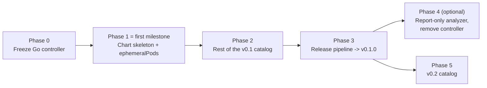

# Plan: Migrate kube-janitor to a Kyverno-native policy pack

**Status**: Draft
**Date**: 2026-11-24
**Decision record**: [ADR-0002](../adr/0002-kyverno-native-cleanup.md)
**Design**: [kyverno-policy-pack.md](../specs/kyverno-policy-pack.md)

---

## 1. Purpose

This plan moves kube-janitor from a custom Go controller to a Kyverno policy pack.
It has three parts:

1. An audit of the current Go controller, with evidence (section 2).
2. A migration matrix that gives one outcome for each component (section 3).
3. Incremental phases. Each phase can ship on its own (section 4).

Facts about Kyverno, Kubernetes, and GitOps tools are in
[compatibility.md](../specs/compatibility.md) and
[gitops-integration.md](../specs/gitops-integration.md). This plan links to them and does not repeat them.

## 2. Audit of the current Go controller

### 2.1 Scope and method

- Commit audited: `c4d6bc3` (`main`, 2026-11-24).
- Every file under `api/`, `cmd/`, `internal/`, `pkg/`, `charts/`, and `.github/workflows/` was read.
- Suspected defects were confirmed with a throwaway Go test. The test wires the real
  classifier, policy engine, and executor exactly as `cmd/manager/main.go:119-147` does.
  It uses the controller-runtime fake client and the equivalent of `--dry-run=false`.
  The test was deleted after the run. Its source and output are in [Appendix A](#appendix-a-audit-probe).
- **Level of confirmation.** The probe confirms each defect at the component level
  (classifier + engine + executor). It does not run the manager.
  The reconciler path reaches the same code with the same input, because:
  - the reconcilers pass the object from `r.Client.Get` (`internal/controller/namespace_reconciler.go:57`,
    `internal/controller/configmap_reconciler.go:44`) to `Classify`, and
  - the controller-runtime v0.19.3 cache sets the GVK on typed reads
    (`sigs.k8s.io/controller-runtime@v0.19.3/pkg/cache/internal/cache_reader.go:100-102`),
    so `Kind` is populated the same way the probe populates it.
- **Exposure.** The repository has no Git tags and no GitHub releases (`git ls-remote --tags origin` and
  `gh release list` return nothing). No container image or chart is known to be published.
  Thus no external user is known to run this code.

### 2.2 Confirmed defects

Severity uses the blast radius when an operator sets `--dry-run=false` and a policy uses `mode: Delete`.

| ID | Severity | Defect | Evidence | Probe |
|----|----------|--------|----------|-------|
| D1 | Critical | A `Delete` policy deletes resources that the classifier marks **Active**. `evaluatePolicy` never checks the class. Active findings have confidence 0.9, and the default delete threshold is 0.9. The executor blocks only objects that have ownerReferences, so resolver-detected "Active" objects (a Namespace with running Pods, a ConfigMap mounted by a Pod) are deleted. | `internal/policy/engine.go:194-268` (no class check), `internal/policy/engine.go:29` (threshold 0.9), `internal/classifier/resolver_strategy.go:43-52` and `internal/classifier/ownerref_strategy.go:82-91` (Active = 0.9), `internal/action/executor.go:146-149` (only ownerRefs block) | A |
| D2 | Critical | Policy selectors are ignored. Matching uses only `selector.kinds[].kind`. `namespaceSelector`, `labelSelector`, `group`, and `version` are never read. A policy written for `env=preview` namespaces applies to every Namespace except the four built-in protected names. | `internal/controller/namespace_reconciler.go:122-127`, `internal/controller/namespace_reconciler.go:140-146`, `internal/policy/engine.go:186-190` | A |
| D3 | High | The per-resource annotation `janitor.io/action=delete` deletes the object regardless of class, confidence, policy mode, or the presence of any policy. Only the classes Protected, Unknown, and Blocked are checked first. This is a confused-deputy path: a principal that can `patch` an object but cannot `delete` it can make the controller delete it with the controller's ClusterRole. | `internal/policy/engine.go:102-105`, `internal/policy/engine.go:149-165`, `charts/kube-janitor/templates/rbac.yaml:13-21` | B |
| D4 | High | The per-policy `confidenceThreshold` has no lower bound (CRD minimum is 0). The 0.7 floor in `config.Validate` applies only to `DefaultDeleteConfidenceThreshold`, and the engine never reads that field. A policy with threshold 0.6 deletes heuristic "Abandoned" findings. `NamespaceResolver` counts only Running/Pending Pods and Deployments, so a Namespace that holds only a PVC, a StatefulSet, a CronJob, or Secrets is "Abandoned". | `api/v1alpha1/janitorpolicy_types.go:130-135`, `internal/policy/engine.go:273-276`, `internal/config/validation.go:15-21`, `internal/resolver/namespace_resolver.go:69-119` (the comment at line 16 says StatefulSets are checked; the code does not check them) | D |
| D5 | High | Most `JanitorPolicy` fields have no effect: `ttl` (including `ttl.default`), `protection`, `orphan`, `prNamespace`, `reporting`, both selectors, and all of `status`. Keys are hard-coded and the default TTL is 0. `NamespaceResolver` stores `PRStateLabelKey` and `ClosedTTL` but never reads them. The README and the sample policy advertise these fields. | `cmd/manager/main.go:129-135` (`NewTTLStrategy("janitor.io/ttl", 0)` at line 131); repo-wide grep finds no reader of `Spec.TTL`, `.Protection`, `.Orphan`, `.Reporting`, `PRNamespace`, `NamespaceSelector`, or `Status()` outside `api/`; `internal/resolver/namespace_resolver.go:24-28` vs `52-120`; `README.md:41-47`; `config/samples/janitorpolicy-sample.yaml:17-36` | E (classifier output only) |
| D6 | High | Pre-flight checks are incomplete and racy. The executor re-reads the object by name. It checks UID, finalizers, and ownerReferences, but it does not re-check the protection annotation, the protection labels, or the class on the fresh object. `Delete` sends no UID or resourceVersion precondition, so a delete-and-recreate between the re-GET and the DELETE removes the new object. Classification runs on the cached object. | `internal/action/executor.go:119-149` (checks), `internal/action/executor.go:159` (`client.Delete(ctx, fresh)` without `client.Preconditions`), `internal/controller/namespace_reconciler.go:57,74` | — (code reading) |
| D7 | Medium | Policy precedence is "first Kind match in API list order", which is alphabetical by name. The package comment says "most specific selector wins". | `internal/policy/engine.go:170-180` vs `internal/policy/engine.go:7` | F |
| D8 | Medium | A `JanitorPolicy` change does not trigger reevaluation. The reconcilers do not watch `JanitorPolicy`. A change takes effect only at the next `RequeueAfter` (default 5m), and only for objects whose last reconcile succeeded. | `internal/controller/namespace_reconciler.go:36-45,112`, `internal/controller/configmap_reconciler.go:24-33,88`, `internal/config/config.go:52` | — |
| D9 | Medium | Safety refusals return errors. The reconcile then fails, the work queue retries with backoff, and the Event step is skipped. Safety blocks are therefore not visible as Events. `ClassOrphaned` can never be deleted, because every orphan has ownerReferences and the executor refuses all of them. | `internal/action/executor.go:110-149`, `internal/controller/namespace_reconciler.go:100-103,106-110` | — |
| D10 | Medium | `ConfigMapResolver` misses projected volumes, ephemeral containers, and Pod templates of workload controllers (a Deployment scaled to 0, a CronJob between runs). `kube-root-ca.crt`, which every Pod mounts through a projected volume, is classified "Abandoned". | `internal/resolver/configmap_resolver.go:78-130` | C |
| D11 | Medium | The chart ClusterRole grants `delete` on Secrets, ServiceAccounts, PVCs, Services, RoleBindings, and ClusterRoleBindings. No reconciler handles these kinds. Only Namespaces and ConfigMaps are reconciled. | `charts/kube-janitor/templates/rbac.yaml:13-21,33-35`, `cmd/manager/main.go:173-180` | — |
| D12 | Low | Resolvers use the uncached API reader. Each ConfigMap reconcile lists all Pods in its Namespace from the API server, for every ConfigMap, every scan interval. | `cmd/manager/main.go:127`, `internal/resolver/configmap_resolver.go:43-45`, `internal/resolver/namespace_resolver.go:70-72,96-98` | — |
| D13 | Low | Observability gaps. Tracing is initialized, but no code creates a span (`CLAUDE.md` lists four spans). The reporter `annotations` flag is unused. All Events use type `Normal`. Dry-run metrics count "would delete" for Active objects. | `cmd/manager/main.go:83-97`, `pkg/tracing/tracing.go:75-83` (no caller in `internal/`), `internal/report/reporter.go:44,53,64`, `internal/action/executor.go:87-90` | — |
| D14 | Low | Release automation is incomplete. GoReleaser runs with `version: latest` and no `.goreleaser.yaml`; its default build targets the module root, which has no `main` package (not executed, so the failure is expected but not proven). The chart is published with chart-releaser to GitHub Pages, not to an OCI registry. The chart ships no CRD. `security.yml` uses actions pinned to `@master`. | `.github/workflows/release.yml:40-47,89-94`, `charts/kube-janitor/` (no `crds/`), `.github/workflows/security.yml:56,73` | — |
| D15 | Info | Documentation drift: `CLAUDE.md` says Go 1.23; `go.mod` says `go 1.26`. | `go.mod`, `CLAUDE.md` | — |

**Net assessment.** The controller is safe only while `--dry-run=true` (the default,
`internal/config/config.go:51`, `charts/kube-janitor/values.yaml:18`). With
`--dry-run=false` and the sample policy changed to `mode: Delete`, D1 and D2 together
delete every non-system Namespace that has a running Pod or a Deployment.

### 2.3 What is worth keeping

The following ideas are sound and carry into the new design as requirements, not as code:

- Safe defaults: nothing is deleted until an explicit opt-in (`internal/config/config.go:51`).
- A hard-coded protected-namespace list enforced at the point of deletion, not only in classification (`internal/action/executor.go:109-117`).
- Foreign finalizers are never removed (`internal/classifier/finalizer_strategy.go:39-49`).
- Explainable findings: `Finding`, `Reason`, `Evidence`, and `Reference` (`internal/domain/types.go:86-180`).
- The rule "absence of evidence is not evidence of absence": heuristic findings stay below the delete threshold (`internal/classifier/resolver_strategy.go:55-57`).

## 3. Migration matrix

Outcomes: Retain, Adapt, Replace with Kyverno, Replace with native Kubernetes,
Move into optional analyzer, Deprecate, Remove after migration.

| Component | Location | Outcome | Rationale |
|-----------|----------|---------|-----------|
| `JanitorPolicy` CRD | `api/v1alpha1/` | **Deprecate, then remove after migration** | Never released (section 2.1). Most fields have no effect (D5). Kyverno `DeletingPolicy` plus chart values replace it. A new CRD would duplicate Kyverno's API. |
| `ProtectionStrategy` | `internal/classifier/protection_strategy.go` | **Replace with Kyverno** | CEL exclusion conditions in each policy, plus an admission policy that guards the protection label. See [security-and-testing.md](../specs/security-and-testing.md). |
| `FinalizerStrategy` | `internal/classifier/finalizer_strategy.go` | **Replace with native Kubernetes** | The API server already blocks final removal until finalizers clear. Kyverno only issues the delete request. The pack never removes finalizers. |
| `TTLStrategy`, `ExpiresAtStrategy` | `internal/classifier/ttl_strategy.go`, `expiresat_strategy.go` | **Replace with Kyverno** | `DeletingPolicy` CEL conditions on lifecycle metadata, or Kyverno's `cleanup.kyverno.io/ttl` label. |
| `OwnerRefStrategy`, `OwnerRefResolver` | `internal/classifier/ownerref_strategy.go`, `internal/resolver/ownerref_resolver.go` | **Replace with native Kubernetes** | The garbage collector deletes dependents whose owners are gone. The executor already refuses to delete owned objects (D9). |
| `ResolverStrategy`, resolver registry, `ConfigMapResolver`, `NamespaceResolver` | `internal/classifier/resolver_strategy.go`, `internal/resolver/` | **Move into optional analyzer** (report-only) | Cross-object reference analysis is the part Kyverno cannot do cleanly. Fix D10 and D12 on the move: projected volumes, Pod templates, metadata-only informers. |
| Policy engine | `internal/policy/` | **Deprecate** | Kyverno evaluates the policies. The confidence model moves to the analyzer as a report attribute, never as a delete gate. |
| Action executor | `internal/action/` | **Remove after migration** | The analyzer does not delete. Its pre-flight rules (D6) become requirements for any future remediation integration. |
| `NamespaceReconciler`, `ConfigMapReconciler` | `internal/controller/` | **Remove after migration** | The analyzer, if built, is a periodic scanner with shared informers, not a per-object reconciler. |
| Domain types | `internal/domain/` | **Move into optional analyzer** (retain) | `Finding`, `Evidence`, and `Reference` are the analyzer's report model. |
| Config, logging | `internal/config/`, `pkg/logging/` | **Move into optional analyzer** | Generic. |
| Metrics | `pkg/metrics/` | **Adapt** (in analyzer) | Deletions are observed through Kyverno's own metrics and Events. The analyzer exports finding counts. |
| Tracing | `pkg/tracing/` | **Deprecate** | Unused (D13). The analyzer may re-add it. |
| Helm chart `kube-janitor` | `charts/kube-janitor/` | **Deprecate** | Mark `deprecated: true` in `Chart.yaml` when the policy chart ships. Do not delete it in the same release. |
| New Helm chart `kube-janitor-policies` | `charts/kube-janitor-policies/` (new) | **New (primary product)** | See [kyverno-policy-pack.md](../specs/kyverno-policy-pack.md). |
| CI workflow | `.github/workflows/ci.yml` | **Adapt** | Add policy and chart jobs. Keep Go jobs while Go code exists. |
| Security workflow | `.github/workflows/security.yml` | **Adapt** | Pin actions by SHA (D14). Add chart scanning. |
| Release workflow | `.github/workflows/release.yml` | **Adapt** | Push the policy chart to OCI and sign it. Drop GoReleaser and image steps until an analyzer exists. |

**Decision for the Go controller.** There is no published release and no known user. Thus a
parallel maintenance period for the controller has no value. The recommended path:

1. Freeze it now: no Phase 2 (real deletion) work.
2. In migration Phase 0, make the binary refuse to start with `--dry-run=false`.
   This closes D1-D4 and D6 at once, at the cost of one guard.
3. Mark the controller and its chart deprecated when the policy chart v0.1.0 ships.
4. Move the resolver and domain packages into the analyzer only when that work starts
   (Phase 4). Delete the rest then.

## 4. Phases



Pinned versions for every phase: Kyverno chart 3.10.0 (v1.20.0), Kyverno CLI v1.20.0, kind v0.33.0
with the digest-pinned images in [compatibility.md](../specs/compatibility.md) section 2.2, Helm 3.22.x and 4.3.x.

### Phase 0 — Freeze the Go controller

| Item | Content |
|------|---------|
| Scope | Remove the deletion risk of the existing code. No new features. |
| Tasks | 1. Make `cmd/manager` exit with an error when `--dry-run=false`, with a message that points to ADR-0002. 2. Add a deprecation notice to `README.md` and to `charts/kube-janitor/Chart.yaml` (`deprecated: true` waits for Phase 3). 3. Update `CLAUDE.md`: roadmap, Go version (D15), new architecture pointer. 4. Add `.claude/settings.local.json` to `.gitignore` (done in this spec change). |
| Dependencies | ADR-0002 accepted. |
| Acceptance criteria | Starting the binary with `--dry-run=false` exits non-zero. All existing tests pass. |
| Tests | New unit test for the flag guard, written first: `Validate()` (or `main` setup) rejects `DryRun=false`. The Appendix A defects are not fixed in Go; the guard makes them unreachable. |
| Migration considerations | No users (section 2.1), so no compatibility shim. |
| Risks | Someone forks and removes the guard. Accepted. |
| Definition of done | PR merged with CI green; `--dry-run=false` refused. |

### Phase 1 — First implementation milestone: chart skeleton and `ephemeralPods`

| Item | Content |
|------|---------|
| Scope | One pack end to end, with every safety layer, in both modes. This proves the architecture. |
| Tasks | 1. `charts/kube-janitor-policies/` skeleton: `Chart.yaml` (`kubeVersion: ">=1.34.0-0"`), `values.yaml`, `values.schema.json`, `_helpers.tpl`, `_conditions.tpl`, `_gate.tpl`, `NOTES.txt`. 2. `ephemeralPods` pack: `DeletingPolicy`, audit `ValidatingPolicy`, aggregated ClusterRole ([kyverno-policy-pack.md](../specs/kyverno-policy-pack.md) sections 6–8). 3. Metadata guard rules G-OPT, G-FMT, G-PROT, G-NS for Pods ([security-and-testing.md](../specs/security-and-testing.md) section 4). 4. `hack/preflight.sh` checks P1–P8. 5. `tests/versions.env`; `tests/kyverno/ephemeral-pods/` (K1–K16 that apply to Pods, A1); Helm tests H1–H11; golden files. 6. Chainsaw tests E1, E2, E3, E5, E6, E7, E8, E10, E12, E13, E15, E16 on Kubernetes 1.37. 7. CI jobs `policy-unit`, `chart-render`, `e2e` (1.37 only in this phase), added in a separate workflow file. |
| Dependencies | Phase 0 merged. Kyverno CLI and Chainsaw available in CI. |
| Acceptance criteria | Default install renders nothing destructive (H1, H2). Audit mode reports exactly the fixtures that delete mode deletes (A1). Every open **[to-test]** item in [kyverno-policy-pack.md](../specs/kyverno-policy-pack.md) section 6.3 is resolved and the spec is updated with the result. |
| Tests | As listed in tasks 5–6. Tests are written before the templates (TDD). |
| Migration considerations | The old chart and Go code stay untouched. |
| Risks | The CEL in section 6.3 does not compile in Kyverno 1.20 → adjust the helpers and the spec. The audit `ValidatingPolicy` cannot evaluate `time.now()` or `namespaceObject` in background scans → fall back to the CLI preview (`hack/preview.sh`) as the audit path and record the decision in the ADR. |
| Definition of done | PR merged with all Phase 1 jobs green; spec updated with resolved **[to-test]** results; no chart published yet. |

### Phase 2 — Complete the v0.1 catalog

| Item | Content |
|------|---------|
| Scope | `previewEnvironments`, `temporaryConfigMaps`, `completedJobsRetention`; guard rule G-MIX; full Kubernetes matrix; GitOps examples. |
| Tasks | 1. Three packs, reusing Phase 1 helpers. 2. Guard rules for Namespaces, ConfigMaps, Jobs, and `janitor.io/job-retention`. 3. G-MIX (Warn + Audit). 4. `kyverno test` K1–K23; Chainsaw E4, E9, E11, E14. 5. `e2e` matrix 1.34–1.37. 6. `examples/` for Argo CD, Flux, GitHub Actions, GitLab CI ([gitops-integration.md](../specs/gitops-integration.md)). 7. Optional `PrometheusRule`. 8. `hack/preview.sh`. |
| Dependencies | Phase 1. |
| Acceptance criteria | All S1–S13 invariants have passing negative tests. Matrix green on four Kubernetes minors. |
| Tests | Full `policy-unit`, `chart-render`, `e2e`. |
| Migration considerations | None for users. |
| Risks | Preview-namespace deletion is the highest blast radius; review E4 and the GitOps exclusions with extra care. |
| Definition of done | All v0.1 packs pass all tests; docs and examples complete. |

### Phase 3 — Release pipeline and v0.1.0

| Item | Content |
|------|---------|
| Scope | Publish the chart safely; GitOps end-to-end tests; deprecate the old chart. |
| Tasks | 1. Release workflow for tag `kube-janitor-policies-v*`: package, push to `oci://ghcr.io/kaiohenricunha/charts`, `cosign sign` and `verify`, attach rendered YAML. 2. Pin all actions by SHA, including `security.yml` (D14). 3. Artifact Hub registration. 4. `gitops-e2e` nightly job (GO2–GO6) with Argo CD 3.6.x and Flux 2.10.x. 5. Mark `charts/kube-janitor` `deprecated: true`; stop publishing it; remove the GoReleaser step until an analyzer exists. 6. README rewrite around the policy chart. |
| Dependencies | Phase 2. |
| Acceptance criteria | All release gates of [security-and-testing.md](../specs/security-and-testing.md) section 7 pass on the tag commit. `helm install oci://…/kube-janitor-policies --version 0.1.0` works on a fresh kind cluster with Kyverno 3.10.0. |
| Tests | All suites + `gitops-e2e` + an install-from-registry smoke test. |
| Migration considerations | First public artifact. From here on, the versioning policy in [compatibility.md](../specs/compatibility.md) section 7 applies. |
| Risks | GHCR or Artifact Hub specifics differ from the spec (marked **[unverified]**). |
| Definition of done | v0.1.0 published, signed, and listed; old chart deprecated. |

### Phase 4 — Optional report-only analyzer; remove the controller

| Item | Content |
|------|---------|
| Scope | Repurpose `internal/resolver` and `internal/domain` as `cmd/analyzer`. Remove `JanitorPolicy`, the engine, the executor, the reconcilers, and the old chart. |
| Tasks | 1. Decide the output format (ADR Q4). 2. Fix D10 and D12 while moving the resolvers. 3. Add Secret, PVC, ServiceAccount, and workload-template resolvers (old roadmap Phase 3). 4. The analyzer has read-only RBAC. 5. Delete the removed packages in the same PR that adds the analyzer. |
| Dependencies | Phase 3; demand from users. |
| Acceptance criteria | The analyzer has no `delete` verb in any RBAC rule. The policy chart has no dependency on it. |
| Tests | Unit tests per resolver with the cases from the classifier spec; envtest for the scanner. |
| Migration considerations | `JanitorPolicy` CRD removal: never published, so no conversion. |
| Risks | Scope creep toward deletion. Blocked by the acceptance criterion above. |
| Definition of done | Analyzer released separately or not at all; dead code gone. |

### Phase 5 — v0.2 catalog

Generic `ephemeralResources` pack (Services, Ingresses, NetworkPolicies), the ConfigMap reference check
after Kyverno fixes #18248, Kyverno N-1 support when 1.21 ships, and Secrets in v0.3 behind a second
confirmation label. Each item follows the Phase 2 template.

## 5. First implementation milestone — exact scope

The next session implements **Phase 0 and Phase 1** in two PRs, in this order.

**PR 1 (Phase 0):** `cmd/manager` refuses `--dry-run=false`; README and `CLAUDE.md` deprecation notes.

**PR 2 (Phase 1):** creates exactly these paths:

```text
charts/kube-janitor-policies/Chart.yaml
charts/kube-janitor-policies/values.yaml
charts/kube-janitor-policies/values.schema.json
charts/kube-janitor-policies/templates/_helpers.tpl
charts/kube-janitor-policies/templates/_conditions.tpl
charts/kube-janitor-policies/templates/_gate.tpl
charts/kube-janitor-policies/templates/NOTES.txt
charts/kube-janitor-policies/templates/packs/ephemeral-pods/deletingpolicy.yaml
charts/kube-janitor-policies/templates/packs/ephemeral-pods/auditpolicy.yaml
charts/kube-janitor-policies/templates/packs/ephemeral-pods/clusterrole.yaml
charts/kube-janitor-policies/templates/guard/validatingadmissionpolicy.yaml
charts/kube-janitor-policies/templates/guard/validatingadmissionpolicybinding.yaml
charts/kube-janitor-policies/ci/{default,audit,delete,e2e}.yaml
tests/versions.env
tests/golden/*.yaml
tests/kyverno/ephemeral-pods/**
tests/chainsaw/packs/**
hack/preflight.sh
.github/workflows/policies.yml
```

Only `ephemeralPods` is implemented. The values keys of the other packs exist in the schema with
`enabled: false` and render nothing, so the values API is stable from the first PR. Out of scope:
other packs, release publishing, GitOps end-to-end jobs, the analyzer.

**Verification commands the PR must show with output:**

```bash
helm lint --strict charts/kube-janitor-policies
helm template t charts/kube-janitor-policies --api-versions policies.kyverno.io/v1 \
  | diff - tests/golden/default.yaml
kyverno test tests/kyverno/ephemeral-pods
chainsaw test tests/chainsaw/packs      # on kind 1.37 with Kyverno chart 3.10.0
hack/preflight.sh                                  # against the same kind cluster
```

After kind runs, delete the cluster, and run `docker volume prune -f`.

## 6. Implementation results

The owner decided on 2026-11-24 that the autonomous run records `[to-test]` results here and in
the PR bodies, and that one final docs PR moves them into `docs/specs/`. Each row names the spec
text that had to change. **Transferred to the specs on 2026-11-24** (the docs PR that follows PR #6);
the four specs now cite these rows as R1–R36.

### 6.1 Phase 0 (PR #3)

| Result | Evidence | Spec change |
|--------|----------|-------------|
| `config.Validate()` refuses `DryRun=false`; the binary exits 1 with a message that names ADR-0002. | `internal/config/validation_test.go`; feature run in PR #3 | none |

### 6.2 Phase 1 (chart skeleton + `ephemeralPods`)

| # | `[to-test]` item (`kyverno-policy-pack.md` §6.3 unless noted) | Result | Evidence | Spec change |
|---|---------------------------------------------------------------|--------|----------|-------------|
| R1 | Item 1: CEL optional syntax `.?labels`, `[?'key']`, `orValue` | **Compiles and works** in Kyverno 1.20.0 `DeletingPolicy` and `ValidatingPolicy`. The spec's earlier `.?['key']` form was invalid and was already corrected in PR #1. | `kyverno test` suites `tests/kyverno/ephemeral-pods{,-audit}` (22/22 each) | Remove the tag. |
| R2 | Item 2: `namespaceObject` for a cluster-scoped `DeletingPolicy` matching namespaced kinds | **Populated.** The `not-protected` condition reads the namespace label correctly. | same suites (case k06 uses a protected namespace label; the `namespaceSelector` excludes it first) | Remove the tag. |
| R3 | Item 3: `timestamp(object.metadata.creationTimestamp)` | **Works** on the unstructured string. | case k15 (default TTL) | Remove the tag. |
| R4 | Item 4: regex guard against malformed values | **Works** for `garbage` and `2026-13-45T99:99:99Z`. | cases k12a, k12b | Remove the tag. |
| R5 | Item 5: day-of-month overflow `2026-02-30T00:00:00Z` | **The regex alone is not enough:** it passes the regex, and `timestamp()` then fails with `type conversion error from 'string' to 'google.protobuf.Timestamp'`. In the cluster, that error would fail the whole run (#18248). **Fix:** a calendar check with `substring`/`int` and leap-year rules before `timestamp()` (`kjp.validDateCEL` in `templates/_conditions.tpl`). | probe run, then cases k12c–k12h (Feb 29 in 2024/2025/1900, Apr 31, Dec 31) | **Change §5.3 and the §6.3 example** to the calendar check; record that Kyverno CEL has `substring` and `int()`. |
| R6 | Item 6: `namespaceObject` for kind `Namespace` | Not tested in Phase 1 (no Namespace pack). The Namespace variant of the helpers never references `namespaceObject`. | `templates/_conditions.tpl` (`scope != Namespaced` branch) | Keep the tag until Phase 2. |
| R7 | Item 7: selector before CEL | The CLI reports `namespaceSelector`/`objectSelector` exclusions as `skip` (not evaluated), so CEL `not-protected-namespace` is a second layer. | cases k01, k03, k05, k06 → `skip` | Remove the tag. |
| R8 | §7 audit mode: `ValidatingPolicy` with `time.now()` and `namespaceObject` | **Compiles; verdicts equal the delete policy (A1)** in the CLI. In-cluster background reporting: see R11. | `tests/kyverno/ephemeral-pods-audit` 22/22 | Update §7. |
| R9 | Audit policy autogen | `autogen.podControllers.controllers: []` is accepted by the v1 schema; set it so that Kyverno generates no Deployment/StatefulSet rules from a Pod policy. | `tests/golden/audit.yaml`; H3 | Add to §7. |
| R10 | `kyverno test` rejects non-policy documents in a policy file | `policy type not supported` for `ClusterRole`. The runner renders each policy alone with `helm template --show-only`. | `tests/kyverno/run.sh` | Add to `security-and-testing.md` §6.1. |
| R11 | In-cluster results (kind 1.37.0, Kyverno 3.10.0 / v1.20.0) | **All Phase 1 scenarios pass:** E1 (preflight P1–P8 all PASS), E2, E3, E5, E6, E7, E8, E10, E12, E13 (0 dropped runs, 0 policy errors), E15, E16 a–d. The audit `ValidatingPolicy` background scan writes a `PolicyReport` fail result for a would-delete Pod (so `time.now()` and `namespaceObject` work in background scans; the §7 fallback to `hack/preview.sh` is not needed). `helm upgrade --reuse-values` re-creates a ClusterRole deleted out of band. | `tests/e2e/run.sh` and `tests/chainsaw/packs/*` | Update §7 and `security-and-testing.md` §6.3 (results). |
| R16 | TTL arming and `resourceFilters` (`security-and-testing.md` §3.3, was **[inferred]**) | **Confirmed in-cluster.** `kyverno_ttl_controller_info{resource_resource="pods"}` appears only after delete mode grants Pods. Then Pods labeled `cleanup.kyverno.io/ttl` that existed before the guard were deleted in **both `default` and `kube-public`**, although `kube-public` is in Kyverno's default `resourceFilters`. P8 caught both before the switch. | e2e driver observation and E16d | Change the tag to **[local]**; strengthen the P8 rationale. |
| R17 | Chainsaw script timeout | The default `exec` timeout is 5 s; a script with four `kubectl` calls was killed (`signal: killed`). Tests that run scripts set `timeouts.exec: 3m`. | first e2e run, `rbac-scope` | Add to `security-and-testing.md` §6.3. |
| R12 | `helm lint` and the render gate | `helm lint` does not execute template `fail` calls, so lint passes even when the gate conditions are violated. H7 and H8 (`helm template`) are the real gate tests. | local Helm 3.20.1 | Add to `compatibility.md` §4.3. |
| R13 | Chainsaw version (`compatibility.md` §5, was **[unverified]**) | Pinned to v0.2.15 (latest release, 2026-05-06), checksum-verified. | `tests/versions.env`, `hack/install-tools.sh` | Replace the tag. |
| R14 | E15 scope in Phase 1 | `temporaryConfigMaps` is not implemented yet, so E15 runs with only `ephemeralPods` in delete mode and checks that ConfigMaps, Namespaces, and Jobs are denied. | `tests/chainsaw/packs/40-rbac-scope` | Note in `security-and-testing.md` E15. |
| R15 | Enabling an unimplemented pack | The render gate fails with `packs.<key> is not implemented` instead of silently rendering nothing. | H6 | Note in `kyverno-policy-pack.md` §8. |

### 6.3 Phase 2 (remaining v0.1 packs)

| # | Item | Result | Evidence | Spec change |
|---|------|--------|----------|-------------|
| R18 | Golden files under Helm 4 | Helm 4.3.2 folds long strings differently from Helm 3; a byte-level golden check fails while the content is the same. H10 compares parsed documents (fixed in PR #4). | PR #4 CI, job "Chart render (Helm v4.3.2)" | Add to `security-and-testing.md` H10. |
| R19 | A1 for a pack whose `objectSelector` has only a `NotIn` expression (Jobs) | Kyverno CLI v1.20.0 reports the protected Job as `skip` for the `DeletingPolicy` and `pass` for the audit `ValidatingPolicy`. Both verdicts are "kept" (the CEL `not-protected` condition enforces it). A1 is defined on verdicts. | `tests/kyverno/completed-jobs-retention-audit` (comment in the test file) | Define A1 on verdicts in `security-and-testing.md` §6.1. |
| R20 | `previewEnvironments` and `namespaceObject` (§6.3 item 6) | The Namespace variant never references `namespaceObject`. Its CEL compiles and gives the expected verdicts for 13 cases. | `tests/kyverno/preview-environments{,-audit}` | Close item 6 as "not used". |
| R21 | Jobs pack CEL | `object.?status.?conditions.orValue([]).filter(...)` and `timestamp(lastTransitionTime) + duration(retention)` compile; `Suspended`, running, recent, native-TTL, and CronJob-owned Jobs are kept. | `tests/kyverno/completed-jobs-retention` 12/12 | Document the condition list in §4.2. |
| R22 | `janitor.io/job-retention` guard | The label lives on Namespaces, so the guard also matches `namespaces` when the Jobs pack is enabled, and the rule checks permission to delete Jobs in that namespace (not the Namespace itself). | H12; `templates/guard/validatingadmissionpolicy.yaml` (`canDeleteJobsHere`) | Update G-OPT in `security-and-testing.md` §4.1. |
| R23 | Namespace delete check | For `namespaces`, the guard's authorizer check sets the namespace attribute to the Namespace's own name, as the API server does for a real `DELETE namespaces/X` (see R27 for the probe). A first version checked without the attribute and was stricter than real authorization. | same template (`canDelete`); e2e `20-guard` step `r27-namespace-scoped-delete-grant` | Note in §4.2. |
| R24 | `default` namespace and debug Pods (side-agent finding) | `default` is in the built-in protected list (invariant S3), so G-NS rejects `janitor.io/ephemeral` there; `kubectl run debug ...` in `default` fails loudly. Kept as specified. The G-NS message now lists the protected namespaces and the fix, and `NOTES.txt` shows `-n <namespace>`. | `templates/guard/validatingadmissionpolicy.yaml`, `templates/NOTES.txt` | **Fix the §4.2 usage example** to pass `-n <namespace>`. **Open question for the owner:** keep `default` protected? |
| R25 | Unimplemented chart features | `preflight.helmTest.enabled=true` fails the render (not silently ignored). | H6 | Note in §8. |
| R34 | Guard removal is not instant | After `helm uninstall --wait`, the API server kept enforcing the deleted `ValidatingAdmissionPolicy` for a short time (cached admission policies): in CI, Pods created right after the uninstall were rejected by G-FMT and G-NS on 3 of 4 Kubernetes versions. The e2e driver now waits until a request that the guard would reject is admitted. Operators who uninstall the chart should expect the guard to keep rejecting cleanup metadata for a few seconds. | PR #5 CI run, jobs `End-to-end (kind 1.34/1.36/1.37)` | Add to `kyverno-policy-pack.md` §8A.4 (uninstall). |

### 6.4 Phase 3 (release pipeline) and run-wide findings

| # | Item | Result | Evidence | Spec change |
|---|------|--------|----------|-------------|
| R26 | TTL arming lag | Kyverno's TTL manager re-checks permissions every `ttlReconciliationInterval` (1m). After delete RBAC is removed, the Pod watcher stops about one interval later (`stopping controller... gvr="/v1, Resource=pods"`); after it is granted, arming also lags. The e2e driver waits up to 150 s for convergence. | cleanup-controller log on the e2e cluster; `tests/e2e/run.sh` (`wait_ttl_watch`) | Add to `security-and-testing.md` §3.3: switching out of delete mode disarms the TTL label only after up to one interval. |
| R27 | Namespace delete authorization | The API server authorizes `DELETE namespaces/X` with the **namespace attribute set to X**: a RoleBinding inside X that grants `delete namespaces` lets a principal delete X, and only X (server dry-run allowed for X, Forbidden for Y). `kubectl auth can-i` drops that attribute and answers "no". The guard's `canDelete` for Namespaces now passes the same attribute, so it admits exactly the principals that the API server lets delete the Namespace. | kind probe (SubjectAccessReview with and without the attribute; `kubectl delete --dry-run=server --as`) | Update R23 and §4.2 of `security-and-testing.md`. |
| R28 | Who may opt a preview Namespace in (side-agent finding) | The labeling identity must be allowed to delete that Namespace. RBAC cannot match name patterns (`pr-*`). Options: (a) CI holds cluster-wide `delete namespaces` (common, broad); (b) a trusted automation creates a RoleBinding in each preview Namespace that lets CI delete only that Namespace (R27). Giving CI itself `create rolebindings` + `bind` to do (b) is equivalent to (a). The guard is not weakened. | R27 | **Open question for the owner**; document the trade-off in `gitops-integration.md` §5.2. |
| R29 | Artifact Hub for OCI charts | Verified upstream: repository URL `oci://ghcr.io/<owner>/charts/kube-janitor-policies`; metadata pushed with `oras push <repo>:artifacthub.io --config /dev/null:application/vnd.cncf.artifacthub.config.v1+yaml artifacthub-repo.yml:application/vnd.cncf.artifacthub.repository-metadata.layer.v1.yaml`. Registering the repository in the Artifact Hub control panel is manual. | `artifacthub/hub` `docs/helm_charts_repositories.md` lines 11–30 | Replace the **[unverified]** tag in `kyverno-policy-pack.md` §8A.3. |
| R30 | Release assets | With every pack disabled, the default render is empty, so the release attaches the chart `.tgz` and an all-packs audit-mode render only. | `release-policies.yml` | Update §8A.3. |
| R31 | GHCR package visibility | **[unverified]** A chart pushed to GHCR by the release workflow may start as a private package; the owner may need to make it public once in the package settings. | — | Add to the release checklist. |
| R32 | GitOps e2e | GO2, GO4, GO5 implemented with real Argo CD v3.6.3 and Flux v2.10.1 (`tests/gitops/run.sh`, nightly workflow). GO3 (ApplicationSet PR generator) is **not done**: it needs a reachable SCM API. GO6 is **not done through Argo CD** (no stable place to assert admission warnings); it is covered without Argo CD by `tests/chainsaw/packs/14-mixed-ownership`. | `tests/gitops/run.sh` header | Update §6.4 of `security-and-testing.md`. |
| R33 | Argo CD version | Argo CD v3.6.3 was released after the research (which found v3.6.2); pinned to v3.6.3. | `gh api repos/argoproj/argo-cd/releases/latest` | Update `gitops-integration.md` §1. |
| R34b | GitOps e2e results | **GO2 PASS** (Argo CD-managed objects: same UIDs after 150 s, app Synced), **GO4 PASS** (Flux: same UIDs; deleting the Kustomization pruned them), **GO5a PASS** (chart via Argo CD; render gate passed with Argo's API versions; Synced/Healthy with the health override). GO5b first failed (R36), then passed after the fix: HelmRelease `Ready=True InstallSucceeded`, 4 `DeletingPolicy` objects and both admission policies installed, so the render gate also passes under Flux helm-controller (live capabilities). | `tests/gitops/run.sh` against `61d720f`; Flux repro cluster | Resolve `compatibility.md` §9 items 2 and 4 (gate under Argo CD and Flux). |
| R35 | `hack/preview.sh` | Listed in the Phase 2 plan, **not implemented**. Audit mode covers the "what would be deleted" need in-cluster (R11). | — | Mark as planned in `kyverno-policy-pack.md` §7. |
| R36 | Flux `chart.spec.valuesFiles` | Flux replaces the chart's `values.yaml` with the listed files; with only `ci/e2e.yaml`, the schema rejected the values (`missing properties 'kyvernoNamespace', 'deletionPropagationPolicy'`). Listing `values.yaml` first fixes it. Inline `values:` (the documented example) merge normally. | HelmRelease status on the repro cluster | Note in `gitops-integration.md` §7.2. |

## Appendix A: Audit probe

The probe was saved as `internal/zzaudit/audit_test.go`, run once, and deleted.
It used `go1.26.0 linux/amd64`, the module's pinned dependencies, and the controller-runtime fake client.
Each test builds the strategy chain, resolver registry, engine (`GlobalDryRun=false`), and executor
exactly as `cmd/manager/main.go:119-147` does.

| Test | Setup | Observed result |
|------|-------|-----------------|
| A | Namespace `team-a`, label `env=prod`, one running Pod. Policy `preview-only`: kind Namespace, `namespaceSelector: env=preview`, `mode: Delete`. | `class=active confidence=0.90`; `action=delete dryRun=false reason="policy preview-only: mode=Delete (confidence=0.90 >= threshold=0.90)"`; `namespace team-a deleted: true` |
| B | ConfigMap `app-config` with `janitor.io/action=delete`, mounted as a volume by a running Pod. No policy. | `class=active confidence=0.90`; `action=delete dryRun=false reason="per-resource annotation janitor.io/action=delete"`; `configmap app-config deleted: true` |
| C | ConfigMap `kube-root-ca.crt`; a running Pod mounts it through a projected volume. | `class=abandoned confidence=0.60` |
| D | Namespace `data-ns` that holds only a PVC. Policy: kind Namespace, `mode: Delete`, `confidenceThreshold: 0.6`. | `class=abandoned confidence=0.60`; `action=delete dryRun=false`; `namespace data-ns deleted: true` |
| E | Namespace `pr-42`, label `env=preview`, age 100h, one running Pod. The classifier is built as in `main.go:131` (default TTL 0); the classifier has no policy input. | `class=active` (not `expired`). Primary evidence for D5 is the grep and `main.go:131`; this test only shows the classifier output. |
| F | Two policies for kind Namespace: `a-report-everything` (`mode: Report`, `labelSelector: team=other`) and `b-delete-preview` (`mode: Delete`). Finding: Expired, 0.9. | `chosen policy=a-report-everything action=report` (first in list wins; its label selector does not match the object) |

Command and summary output:

```text
$ go test -count=1 -v ./internal/zzaudit/
    audit_test.go:100: finding: class=active confidence=0.90
    audit_test.go:103: decision: action=delete dryRun=false reason="policy preview-only: mode=Delete (confidence=0.90 >= threshold=0.90)"
    audit_test.go:105: namespace team-a deleted: true
--- PASS: TestAudit_A_ActiveNamespaceOutsideSelectorIsDeleted (0.00s)
    audit_test.go:119: finding: class=active confidence=0.90
    audit_test.go:122: decision: action=delete dryRun=false reason="per-resource annotation janitor.io/action=delete"
    audit_test.go:124: configmap app-config deleted: true
--- PASS: TestAudit_B_AnnotationOverrideDeletesActiveConfigMap (0.00s)
    audit_test.go:140: finding: class=abandoned confidence=0.60
--- PASS: TestAudit_C_ProjectedVolumeReferenceMissed (0.00s)
    audit_test.go:152: finding: class=abandoned confidence=0.60
    audit_test.go:156: decision: action=delete dryRun=false
    audit_test.go:158: namespace data-ns deleted: true
--- PASS: TestAudit_D_LowPolicyThresholdDeletesAbandonedNamespaceWithPVC (0.00s)
    audit_test.go:169: finding for 100h-old namespace under a 72h default-TTL policy: class=active
--- PASS: TestAudit_E_PolicyDefaultTTLIgnored (0.00s)
    audit_test.go:184: chosen policy=a-report-everything action=report
--- PASS: TestAudit_F_FirstKindMatchWins (0.00s)
PASS
ok  	github.com/kaiohenricunha/kube-janitor/internal/zzaudit	0.031s
```

To reproduce: recreate the test from the table above in a scratch package inside the module,
using `fake.NewClientBuilder()` and the constructors in `cmd/manager/main.go:119-147`. A copy of the
source was kept only in the session scratchpad, which is not durable; the table above is the record.
The policy pack's negative tests K1, K5, K13, and E5 cover the same failure classes for the new design.
