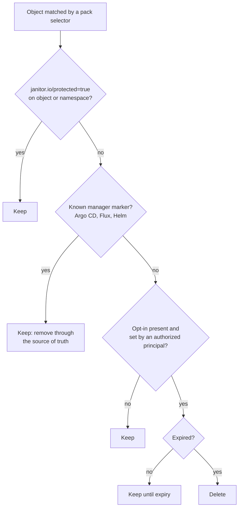

# Spec: GitOps and non-GitOps integration

**Status**: Implemented in kube-janitor-policies 0.1.0 (results: [kyverno-migration.md](../plans/kyverno-migration.md) §6)
**Date**: 2026-11-24
**Related**: [kyverno-policy-pack.md](kyverno-policy-pack.md) · [security-and-testing.md](security-and-testing.md) · [ADR-0002](../adr/0002-kyverno-native-cleanup.md)

---

## 1. Summary

A resource that a GitOps tool manages must be removed through its source of truth, not deleted
directly. If Kyverno deletes it, the GitOps tool either recreates it (a delete-and-recreate loop)
or reports drift. This spec defines how the pack recognizes managers, what it does in each
ownership case, and the integration patterns it supports.

Claim tags: **[upstream]** (with source), **[inferred]** (from upstream source code or behavior, no doc
statement), **[local]** (reproduced in kube-janitor's own tests), **[to-test]**. All tool versions were checked on
2026-11-24: Argo CD v3.6.2 (v3.6.3 was released the same day and is the version tested; R33), Flux v2.10.1
(kustomize-controller v1.10.2, helm-controller v1.7.2), Helm 4.3.2 and 3.22.1.

## 2. Ownership model



Three rules:

1. **Known manager → never delete directly.** The object goes away when its source removes it.
2. **Unknown manager → delete only with an authorized opt-in.** "Authorized" means that the metadata
   guard admitted the opt-in because the principal could delete the object itself
   ([security-and-testing.md](security-and-testing.md) section 4).
3. **Doubt → keep.** An ambiguous marker counts as a manager marker.

## 3. Manager detection

Detection reads only the object's own metadata (principle P1 in [kyverno-policy-pack.md](kyverno-policy-pack.md)).

| Manager | Marker the pack checks | Source | Notes |
|---------|------------------------|--------|-------|
| Argo CD (annotation tracking, default since 3.0) | annotation `argocd.argoproj.io/tracking-id` | [upstream] "`annotation` (default) - Argo CD uses the `argocd.argoproj.io/tracking-id` annotation" — https://argo-cd.readthedocs.io/en/stable/user-guide/resource_tracking/ | Value: `<app>:<group>/<kind>:<namespace>/<name>`. Present on synced objects with Argo CD v3.6.3 **[local]** (GO2). |
| Argo CD (label tracking) | label `app.kubernetes.io/instance`, or the custom `application.instanceLabelKey` (commonly `argocd.argoproj.io/instance`) | same page | `app.kubernetes.io/instance` is also the Helm chart convention ([upstream] Helm labels best practices). The pack treats it as a manager marker anyway (rule 3). |
| Flux Kustomization | labels with prefix `kustomize.toolkit.fluxcd.io/` (`name`, `namespace`) | [upstream] Flux migration doc example `-l=kustomize.toolkit.fluxcd.io/name=app`; source `fluxcd/pkg ssa/manager.go` `GetOwnerLabels` | Not listed on the current v1 spec page. Present with Flux v2.10.1 **[local]** (GO4). |
| Flux HelmRelease | labels with prefix `helm.toolkit.fluxcd.io/` (`name`, `namespace`) | [upstream] helm-controller CHANGELOG: "labeled with `helm.toolkit.fluxcd.io/name` and `helm.toolkit.fluxcd.io/namespace`" | — |
| Helm (direct) | annotations with prefix `meta.helm.sh/`, or label `app.kubernetes.io/managed-by: Helm` | [upstream] "Helm adds these annotations…: `meta.helm.sh/release-name`… `meta.helm.sh/release-namespace`" — https://helm.sh/docs/topics/advanced/ | `helm template` output does not contain `meta.helm.sh/*` **[inferred, Helm source]**, so Argo CD-rendered Helm charts have only the chart's own labels. |

The exact CEL is in [kyverno-policy-pack.md](kyverno-policy-pack.md) section 6.3 (condition `no-known-manager`).

### 3.1 Limits of marker detection

| Case | Result | Why accepted |
|------|--------|--------------|
| A Namespace created by Argo CD `CreateNamespace=true` without `managedNamespaceMetadata` tracking | No marker on the Namespace. [upstream] "The generated namespace is normally not tracked with Argo CD." | Handled by pattern rules in section 5 and the mixed-ownership guard in section 6. |
| A tool that leaves no marker (kubectl, a custom operator, Terraform) | Treated as "unknown manager"; needs an authorized opt-in. | The opt-in itself is the owner's statement. |
| Someone copies a marker onto an object | The object becomes undeletable by the pack. | Fail-safe direction. |
| Someone strips a marker | The object still needs an authorized opt-in. | The guard checks delete permission of the principal who adds the opt-in. |
| `managedFields` managers (`argocd-controller`, `kustomize-controller`, `helm`) | Not used in v0.1. | Field-manager names are not a stable contract. Candidate signal for the analyzer. |

## 4. GitOps behavior that shapes the design

| Behavior | Fact | Source |
|----------|------|--------|
| Argo CD recreates deleted resources only with self-heal | [upstream] "By default, changes that are made to the live cluster will not trigger automated sync." With `selfHeal: true`, sync is retried after the self-heal timeout. The docs say 5 seconds; the flag reference and source say timeout `0` with backoff `2s` × `3`, capped at `300s`. | auto_sync doc; `argocd-cmd-params-cm.yaml`; `cmd/argocd-application-controller/commands/argocd_application_controller.go` L267-271 |
| Argo CD prune is off by default | [upstream] "automated sync will not delete resources when Argo CD detects the resource is no longer defined in Git" unless `prune: true`. | auto_sync doc |
| Application deletion cascades only with the finalizer | [upstream] default foreground cascade with `resources-finalizer.argocd.argoproj.io`; non-cascading deletion removes the finalizer. | app_deletion doc |
| `CreateNamespace` namespaces survive Application deletion | [upstream] untracked unless `managedNamespaceMetadata` carries a tracking annotation; then Argo CD may delete it. | sync-options doc |
| ApplicationSet PR generator removes the Application when the PR closes | [upstream] "Application will be removed when a Pull Request no longer meets the specified criteria." Polling default 30 minutes; webhooks remove the delay. | Generators-Pull-Request doc |
| ApplicationSet must be allowed to delete | [upstream] policy `sync` (default) or `create-delete`; `create-only` and `create-update` prevent deletion. `preserveResourcesOnDeletion: true` keeps resources. | Controlling-Resource-Modification, Application-Deletion docs |
| Flux Kustomization corrects drift every interval | [upstream] drift detection "every ten minutes"; [inferred, source] an object deleted out-of-band is re-created at the next reconcile unless `kustomize.toolkit.fluxcd.io/reconcile: disabled` or `ssa: Ignore`. | Kustomization doc; `fluxcd/pkg ssa/manager_apply.go` L405-419 |
| Flux prune and deletion policy | [upstream] `.spec.prune` required; `spec.deletionPolicy`: `MirrorPrune` (default), `Delete`, `WaitForTermination`, `Orphan`. Deleting a `prune: true` Kustomization removed its objects **[local]** (GO4). | Kustomization doc |
| HelmRelease drift detection default | [upstream] "defaults to DiffModeDisabled"; with it disabled, an object deleted out-of-band stays deleted until the next Helm action **[inferred]**. | helm-controller API v2 doc |
| HelmRelease uninstall | [upstream, source] deleting a non-suspended HelmRelease uninstalls the release; `install.createNamespace` namespaces are not garbage collected. | helm-controller `helmrelease_controller.go` L464-470; HelmRelease doc |

**Consequence.** Direct deletion of a GitOps-managed object is either undone (Argo CD with self-heal,
Flux Kustomization) or leaves silent drift (Argo CD without self-heal, HelmRelease with default drift
detection). Neither outcome is cleanup. The pack therefore never deletes such objects.

**Verified [local].** With every pack in delete mode and a one-minute schedule, opted-in, long-expired
Pods and ConfigMaps managed by Argo CD (GO2) and by a Flux Kustomization (GO4) kept the same UIDs over
150 seconds: no deletion and no delete-and-recreate loop.

## 5. Supported workflows

### 5.1 Matrix

| Environment created by | Removed by | kube-janitor role | Opt-in on Namespace? |
|------------------------|-----------|-------------------|----------------------|
| CI with `kubectl` / `helm --create-namespace` | kube-janitor `previewEnvironments` after expiry, or CI on PR close | Primary cleanup + backstop | **Yes** |
| Argo CD ApplicationSet PR generator, namespace tracked via `managedNamespaceMetadata` | Argo CD (Application deletion cascades, namespace included) | Templates only | **No** |
| Argo CD ApplicationSet PR generator, `CreateNamespace=true` untracked | Argo CD removes the resources; the empty namespace stays | Backstop for the leftover namespace | Yes, but expiry is set **only on PR close** (pattern 5.3) |
| Flux (Kustomization per preview) | Flux, by deleting the Kustomization with `prune: true` | Templates only | **No** |
| Flux HelmRelease per preview | Flux uninstalls the release; `createNamespace` namespace stays | Backstop for the leftover namespace | Yes, expiry set on PR close |
| `kubectl debug` / `kubectl run` | kube-janitor `ephemeralPods` | Primary | n/a (label on the Pod; use a namespace that is not protected) |
| Test suite creating ConfigMaps | kube-janitor `temporaryConfigMaps` | Primary | n/a |

### 5.2 Pattern A — CI-owned preview namespace (non-GitOps)

```yaml
# GitHub Actions excerpt (illustrative; full file: examples/github-actions/preview-namespace.yml).
# The CI identity must be allowed to delete the namespace, or the metadata guard rejects the labels.
- name: Create preview namespace
  run: |
    NS="pr-${{ github.event.number }}"
    kubectl create namespace "$NS" --dry-run=client -o yaml \
      | kubectl label --local -f - janitor.io/ephemeral=true janitor.io/owner=gha-${{ github.repository_id }} -o yaml \
      | kubectl annotate --local -f - janitor.io/expires-at="$(date -u -d '+72 hours' +%Y-%m-%dT%H:%M:%SZ)" -o yaml \
      | kubectl apply -f -
    helm upgrade --install app ./chart -n "$NS"

# on: pull_request: types: [closed]
- name: Expire preview namespace
  run: |
    kubectl annotate namespace "pr-${{ github.event.number }}" --overwrite \
      janitor.io/expires-at="$(date -u -d '+1 hour' +%Y-%m-%dT%H:%M:%SZ)"
```

**Who may opt a namespace in (R28).** The metadata guard admits `janitor.io/ephemeral` on a Namespace only from a
principal that may delete that Namespace. The API server authorizes `DELETE namespaces/X` with the namespace
attribute set to `X`, so a RoleBinding inside `X` can grant delete on `X` alone; the guard checks the same way
**[local]** (R27). RBAC cannot match name patterns such as `pr-*`. So the CI identity either holds cluster-wide
`delete namespaces` (common, broad), or a trusted automation creates, in each new preview namespace, a RoleBinding
that lets CI delete only that namespace. Giving CI itself `create rolebindings` plus `bind` to do that is equivalent
to the cluster-wide grant. Choose before you enable `previewEnvironments`; do not weaken the guard instead.

The PR-close job can also delete the namespace directly. Setting a short expiry instead gives a
grace period and leaves the decision trail in metadata. If the close job never runs, the 72h expiry is the backstop.

### 5.3 Pattern B — Argo CD ApplicationSet PR generator

Recommended template (full file: `examples/argocd/applicationset-previews.yaml`):

```yaml
apiVersion: argoproj.io/v1alpha1
kind: ApplicationSet
metadata:
  name: previews
spec:
  # applicationsSync must allow deletion (default policy "sync").
  syncPolicy:
    preserveResourcesOnDeletion: false     # Application keeps the resources finalizer
  generators:
    - pullRequest:
        github: { owner: example, repo: app }
        requeueAfterSeconds: 300
  template:
    metadata:
      name: 'preview-{{number}}'
    spec:
      destination:
        namespace: 'pr-{{number}}'
      syncPolicy:
        automated: { prune: true, selfHeal: true }
        syncOptions: [CreateNamespace=true]
        managedNamespaceMetadata:
          annotations:
            # Makes Argo CD own (and delete) the namespace. Value format is
            # <app>:<group>/<kind>:<namespace>/<name>; see section 8, item G1.
            argocd.argoproj.io/tracking-id: 'preview-{{number}}:/Namespace:pr-{{number}}/pr-{{number}}'
```

With this template, Argo CD removes the whole environment when the PR closes. kube-janitor does
nothing. The Namespace carries a tracking annotation, so the `previewEnvironments` pack ignores it even
if someone adds the opt-in label. This pattern is not covered by an end-to-end test (GO3; R32).

If a team cannot use namespace tracking, it uses `CreateNamespace=true` without tracking and lets
kube-janitor remove the leftover empty namespace: CI labels the namespace `janitor.io/ephemeral=true`
**without** an expiry annotation and with a long `defaultTTL`, and the PR-close workflow sets
`janitor.io/expires-at` to now plus a grace period longer than the ApplicationSet requeue interval.

### 5.4 Pattern C — Flux

Use one Kustomization (or HelmRelease) per preview, generated by CI or by a Flux ResourceSet-style tool,
with `prune: true` and `deletionPolicy: Delete`. Deleting it removes the environment (GO4 confirms
pruning **[local]**). For a `createNamespace` HelmRelease, apply pattern A's PR-close step to the leftover namespace.

## 6. Mixed clusters and failure behavior

| Situation | Default behavior | Mechanism |
|-----------|------------------|-----------|
| Ownership unknown (no marker) and no opt-in | Keep | Selector requires the opt-in label. |
| Ownership unknown, opt-in present | Delete after expiry | Guard verified the opt-in author could delete the object. |
| Resource manually modified after a GitOps sync | Keep (marker still present) | Marker check. |
| Managed by Helm, not GitOps | Keep | `meta.helm.sh/*` / `managed-by: Helm` marker. Remove with `helm uninstall`. |
| Namespace with resources from several teams | Namespace deletion only if the Namespace object itself is opted in; per-object packs act per object | A team that shares a namespace must not opt the namespace in. The guard requires namespace-delete permission for that opt-in. |
| GitOps object created inside an opted-in namespace | Admission **warning** and audit annotation (default `metadataGuard.mixedOwnership: [Warn, Audit]`) | Guard rule G-MIX ([security-and-testing.md](security-and-testing.md) section 4), verified with an Argo CD-marked ConfigMap **[local]** (e2e `14-mixed-ownership`). The namespace is still deleted at expiry; the warning tells the GitOps author before that happens. Operators can raise it to `Deny`. |
| Kyverno deletes an object that Argo CD or Flux then recreates | Cannot happen for marked objects (GO2, GO4). For an unmarked namespace that an untracked Application targets: the namespace is deleted, Argo CD self-heal recreates it on the next sync if `CreateNamespace=true`, and the pack deletes it again only if the new namespace is opted in and expired (a recreated namespace has a new `creationTimestamp` and no labels unless `managedNamespaceMetadata` adds them). | Documented. Pattern B avoids it. Do not put the opt-in label in `managedNamespaceMetadata` together with an expiry. |
| GitOps application removed while cleanup is pending | The GitOps tool removes its objects; kube-janitor removes the leftover opted-in namespace at expiry | Patterns B and C. |
| Argo CD shows `DeletingPolicy` as Degraded | Expected in Kyverno 1.20.0 (Ready never set, #18813) | Section 7.3. |

## 7. Installing kube-janitor-policies with GitOps

### 7.1 Argo CD

```yaml
apiVersion: argoproj.io/v1alpha1
kind: Application
metadata:
  name: kube-janitor-policies
  namespace: argocd
spec:
  project: platform
  source:
    repoURL: ghcr.io/kaiohenricunha/charts      # OCI, no scheme (Argo CD convention)
    chart: kube-janitor-policies
    targetRevision: 0.1.0                       # pin an exact version
    helm:
      valuesObject:
        packs:
          ephemeralPods: { enabled: true, mode: audit }
  destination:
    server: https://kubernetes.default.svc
    namespace: kube-janitor
  syncPolicy:
    automated: { prune: true, selfHeal: true }
    syncOptions: [CreateNamespace=true, ServerSideApply=true]
```

- [upstream] Argo CD renders with `helm template` and passes the target cluster's API versions, so the
  render-time API gate ([compatibility.md](compatibility.md) section 4.3) works. **[local]** GO5a: an Argo CD
  v3.6.3 Application installed the chart from the Git repository and reached Synced/Healthy (with the
  health override of section 7.3).
- [upstream] Argo CD 3.5+ renders with Helm 4 only; Helm 4 OCI is stricter.
- The OCI `repoURL` form for Argo CD Helm OCI sources is still untested: the GitOps job installs the chart from
  the Git repository because nothing is published yet.

### 7.2 Flux

```yaml
apiVersion: source.toolkit.fluxcd.io/v1
kind: OCIRepository
metadata: { name: kube-janitor-policies, namespace: flux-system }
spec:
  interval: 1h
  url: oci://ghcr.io/kaiohenricunha/charts/kube-janitor-policies
  ref: { tag: 0.1.0 }
  layerSelector:
    mediaType: application/vnd.cncf.helm.chart.content.v1.tar+gzip
    operation: copy
  verify: { provider: cosign }
---
apiVersion: helm.toolkit.fluxcd.io/v2
kind: HelmRelease
metadata: { name: kube-janitor-policies, namespace: flux-system }
spec:
  interval: 30m
  targetNamespace: kube-janitor
  install: { createNamespace: true }
  chartRef: { kind: OCIRepository, name: kube-janitor-policies }
  values:
    packs:
      ephemeralPods: { enabled: true, mode: audit }
```

The chart has no Helm test hook in 0.1.0, so `spec.test.enable` has nothing to run.

The exact Flux `OCIRepository` and `chartRef` field names are still untested: the GitOps job installs the chart from a
`GitRepository` (GO5b passes). With `chart.spec.valuesFiles`, list the chart's `values.yaml` first: Flux replaces the
chart's default values with the listed files, and the chart's schema then rejects partial values **[local]** (R36).
Inline `values:`, as above, are merged over the chart's defaults.

### 7.3 Argo CD health for `DeletingPolicy`

Kyverno 1.20.0 never sets `status.conditionStatus.ready` (#18813), and Argo CD reports the policy as
Degraded. Until upstream fixes it, apply the resource customization in
[`examples/argocd/argocd-cm-deletingpolicy-health.yaml`](../../examples/argocd/argocd-cm-deletingpolicy-health.yaml)
(used by the GitOps end-to-end test, GO5a). It marks
`policies.kyverno.io/DeletingPolicy` Healthy when `metadata.generation` exists, and Progressing otherwise.
Do not derive health from `lastExecutionTime`, because the first run can be minutes away.

## 8. Integration strategy comparison

| # | Strategy | Complexity | Reliability | Coupling | User experience | Decision |
|---|----------|------------|-------------|----------|-----------------|----------|
| 1 | No integration, documentation only | Very low | Depends on users | None | Users must find the right settings | Part of v0.1 (this spec) |
| 2 | Reusable GitOps templates (ApplicationSet, Flux, CI snippets in `examples/`) | Low | High: the GitOps tool does the deletion | Low (examples, not code) | Copy and adapt | **v0.1** (shipped in `examples/`) |
| 3 | CI-driven Git changes (PR-close job removes an environment from a GitOps repo) | Medium | High | Medium (repo layout) | Good for teams with env repos | Example in v0.2 |
| 4 | Optional Git provider integration (read PR state from GitHub/GitLab) | High | Medium (tokens, rate limits, outages) | High | Automatic | **Rejected** for the pack. The ApplicationSet PR generator already does this. |
| 5 | Custom cleanup coordination component | Very high | Unknown | Very high | Opaque | **Rejected.** It recreates the controller this migration retires. |

Open GitOps items:

- G1. Confirm whether Argo CD writes the destination namespace or an empty segment in the tracking-id of
  cluster-scoped objects (the 3.0 upgrade note and the `managedNamespaceMetadata` example disagree). The
  pack checks only the annotation's presence, so this affects only the template in pattern B. **[to-test]**
- G2. Confirm the Argo CD self-heal delay in practice (doc 5s versus code backoff). It does not change the design.
- G3. Test pattern B end to end (needs a reachable SCM API for the PR generator; GO3, R32).
