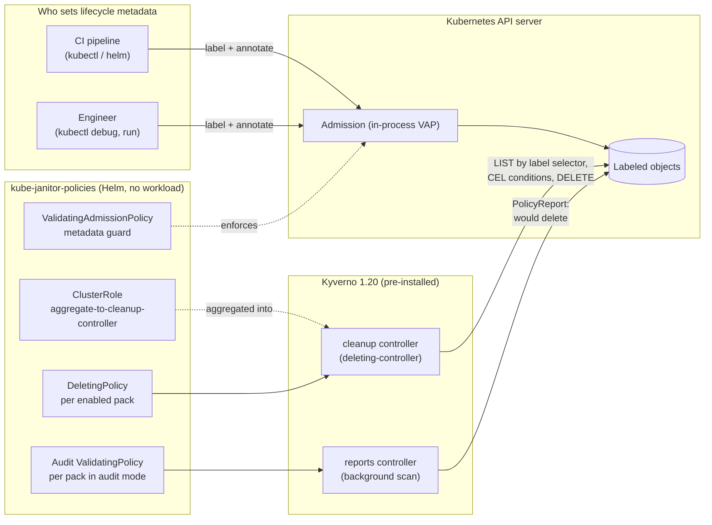
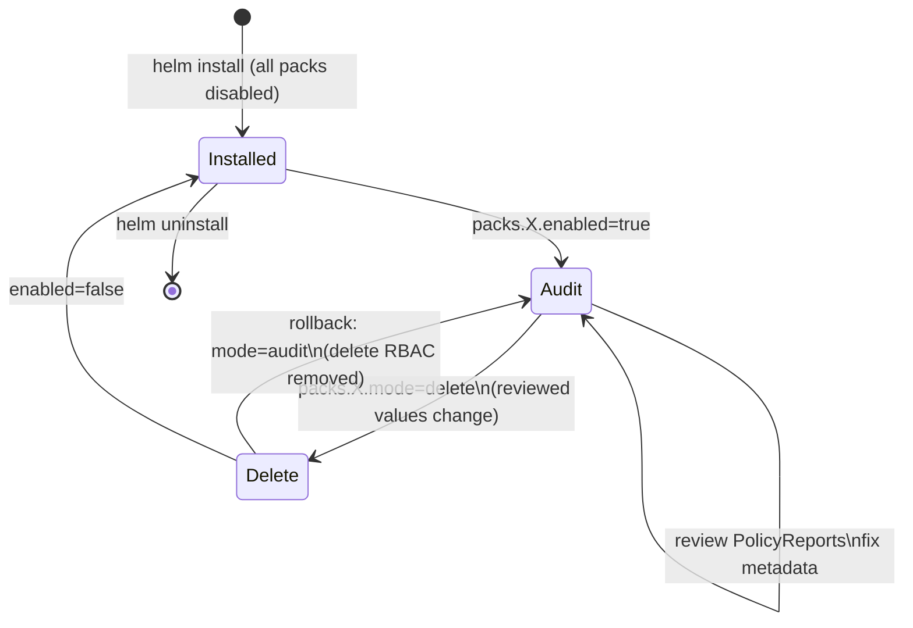

# Spec: kube-janitor-policies — Kyverno-native cleanup policy pack

**Status**: Draft
**Date**: 2026-11-24
**Phase**: migration Phases 1–3 (see [kyverno-migration.md](../plans/kyverno-migration.md))
**Decision record**: [ADR-0002](../adr/0002-kyverno-native-cleanup.md)
**Companion specs**: [compatibility.md](compatibility.md) · [gitops-integration.md](gitops-integration.md) · [security-and-testing.md](security-and-testing.md)

---

## 1. Summary

`kube-janitor-policies` is a Helm chart of Kyverno `DeletingPolicy` resources plus the RBAC and the
admission guard they need. It removes resources whose owners explicitly marked them as temporary,
after their expiry time. It never deletes a resource only because it looks old or unused.

The chart is installed into a cluster that already runs Kyverno 1.20 or later. It has no
controller and no image. Every pack is **disabled** by default. An enabled pack starts in
**audit** mode, which reports what it would delete and deletes nothing.

Claim tags follow [compatibility.md](compatibility.md): **[upstream]**, **[local]**, **[to-test]**, **[unverified]**.
Upstream facts used by this spec are listed once in section 11 with their sources.

## 2. Goals and non-goals

### Goals

- G1. Solve four real problems: expired preview environments, forgotten debug Pods,
  temporary ConfigMaps, and finished Jobs that nobody cleans up.
- G2. Install with one `helm install` into a cluster that has Kyverno.
- G3. Delete nothing until an operator enables a pack **and** switches it to `delete` mode.
- G4. Never fight a GitOps controller (see [gitops-integration.md](gitops-integration.md)).
- G5. Make every deletion explainable from metadata on the object and a policy in Git.

### Non-goals

- N1. Detect unused or abandoned resources. That needs cross-object analysis. It belongs to the
  optional analyzer, which is report-only (section 10).
- N2. Replace Kubernetes-native mechanisms (Job `ttlSecondsAfterFinished`, CronJob history limits,
  owner-reference garbage collection).
- N3. Talk to Git providers.
- N4. Install or configure Kyverno.

## 3. Architecture



Data flow for one deletion:

1. An authorized principal creates or labels an object with `janitor.io/ephemeral: "true"` and, optionally, `janitor.io/expires-at`.
2. The in-process `ValidatingAdmissionPolicy` (the metadata guard) admits the change only if the principal may delete that object itself, and the expiry value parses (see [security-and-testing.md](security-and-testing.md) section 4).
3. On each schedule tick, the Kyverno cleanup controller lists objects of the pack's kinds with a server-side label selector **[upstream]**, evaluates the CEL conditions on each live object, and deletes those for which all conditions are true.
4. Kyverno metrics record the deletion. API server audit logs record the DELETE by the cleanup controller ServiceAccount.

### 3.1 Design principles

| # | Principle | Consequence |
|---|-----------|-------------|
| P1 | Object-local decisions only. | v0.1 policies read only `object`, `namespaceObject`, and `time.now()`. They never call `resource.List`, `resource.Get`, `http`, or `globalContext` (section 6.4). |
| P2 | Explicit opt-in on the object, or on the namespace for objective criteria. | No pack selects objects by age or by kind alone. |
| P3 | Fail safe on doubt. | Missing or malformed metadata, an unknown manager, or a GitOps marker each mean "keep". |
| P4 | One source for each condition. | Delete-mode and audit-mode policies render the same CEL from shared template helpers. |
| P5 | Native first. | The Jobs pack only covers Jobs that native TTL and CronJob limits do not cover. |
| P6 | Defense in depth. | Selector filter, CEL conditions, Kyverno `resourceFilters`, RBAC, and admission each block a different failure (see [security-and-testing.md](security-and-testing.md) section 2). |

## 4. Policy catalog

### 4.1 Packs in v0.1

| Pack (values key) | Problem | Target kinds | Policy kind | Selection | Default TTL |
|-------------------|---------|--------------|-------------|-----------|-------------|
| `previewEnvironments` | PR namespaces that outlive their PR | `Namespace` | `DeletingPolicy` (cluster) | object label `janitor.io/ephemeral=true` | 72h |
| `ephemeralPods` | Debug and one-off Pods left running | `Pod` | `DeletingPolicy` | object label `janitor.io/ephemeral=true`; no ownerReferences | 24h |
| `temporaryConfigMaps` | ConfigMaps created for one test run | `ConfigMap` | `DeletingPolicy` | object label `janitor.io/ephemeral=true`; no ownerReferences | 168h |
| `completedJobsRetention` | Finished standalone Jobs without native TTL | `Job` (`batch/v1`) | `DeletingPolicy` | namespace label `janitor.io/job-retention=enabled`; Job finished; no ownerReferences; no `ttlSecondsAfterFinished` | retention 168h after completion |

`NamespacedDeletingPolicy` cannot target cluster-scoped kinds **[upstream]**, so the
`previewEnvironments` pack must use a cluster-scoped `DeletingPolicy`. For uniformity, all v0.1
packs use cluster-scoped `DeletingPolicy` and restrict namespaces with `namespaceSelector`.

### 4.2 Per-pack details

#### previewEnvironments

| Item | Specification |
|------|---------------|
| Required metadata | Label `janitor.io/ephemeral: "true"` on the Namespace. Optional annotation `janitor.io/expires-at`. |
| Detection | Expiry passed (section 5.3). Namespace not `Terminating`. No GitOps or Helm marker on the Namespace object. Name not in the protected list. Label `janitor.io/protected` not `true`. |
| Cleanup ownership | The CI system that created the namespace. It sets the opt-in label at creation. On PR close it sets `janitor.io/expires-at` to now plus a grace period (pattern in [gitops-integration.md](gitops-integration.md) section 5). |
| RBAC added | `namespaces`: get, list, watch, delete. |
| Default | Disabled. When enabled: `mode: audit`. |
| GitOps | A GitOps-managed preview is removed by its GitOps tool. The pack is a backstop for namespaces that the GitOps tool leaves behind. See [gitops-integration.md](gitops-integration.md). |
| Failure modes | A finalizer in the namespace content keeps it `Terminating` **[upstream]**; the pack skips terminating namespaces and never removes finalizers. A GitOps Application that still targets the namespace recreates it; see [gitops-integration.md](gitops-integration.md) section 6. |
| Blast radius | Highest of all packs: one false positive deletes every object in a namespace. |
| Release | v0.1 |

#### ephemeralPods

| Item | Specification |
|------|---------------|
| Required metadata | Label `janitor.io/ephemeral: "true"` on the Pod. Optional `janitor.io/expires-at`. |
| Detection | Expiry passed. No `ownerReferences` (workload-owned Pods are excluded; their controller recreates them). No manager marker. Not terminating. |
| RBAC added | `pods`: get, list, watch, delete. |
| Default | Disabled; `mode: audit` when enabled. |
| Failure modes | A Pod with a finalizer stays terminating; the policy skips it. |
| Blast radius | One Pod per false positive. |
| Release | v0.1 |

Usage example: `kubectl run debug-$USER --image=busybox -l janitor.io/ephemeral=true -- sleep infinity`.

#### temporaryConfigMaps

| Item | Specification |
|------|---------------|
| Required metadata | Label `janitor.io/ephemeral: "true"`. Optional `janitor.io/expires-at`. |
| Detection | Expiry passed. No `ownerReferences`. No manager marker. Not terminating. **No reference check** in v0.1 (principle P1). |
| RBAC added | `configmaps`: get, list, watch, delete. |
| Default | Disabled; `mode: audit` when enabled. |
| Failure modes | A running Pod that mounts the ConfigMap keeps its last projected content, but new Pods that need it fail to start. The opt-in label states the owner's intent; the docs say so. A reference check is a v0.2 candidate (section 12). |
| Blast radius | One ConfigMap per false positive; workload impact possible as above. |
| Release | v0.1 |

#### completedJobsRetention

| Item | Specification |
|------|---------------|
| Required metadata | Namespace label `janitor.io/job-retention: "enabled"`. No label on the Job. |
| Detection | Condition `Complete=True` or `Failed=True`. `status.completionTime` (or the condition `lastTransitionTime` for failed Jobs) is older than `retention`. No `ownerReferences` (CronJob-owned Jobs are left to `successfulJobsHistoryLimit`/`failedJobsHistoryLimit`, defaults 3 and 1 **[upstream]**). `spec.ttlSecondsAfterFinished` unset (native TTL already handles those Jobs). No manager marker. |
| Native alternative | Prefer `ttlSecondsAfterFinished` in the Job spec (GA since 1.23 **[upstream]**). The pack covers Jobs that lack it. |
| RBAC added | `jobs.batch`: get, list, watch, delete. Propagation: `Background` so Pods are removed. |
| Default | Disabled; `mode: audit` when enabled. |
| Failure modes | A GitOps-managed Job that is deleted is re-created and re-run by self-heal. The manager-marker condition excludes it. |
| Blast radius | Loss of finished-Job status and logs in opted-in namespaces. |
| Release | v0.1 |

### 4.3 Resource eligibility and risk matrix

| Resource / scenario | Automatic deletion | Mechanism | Risk if wrong | Release |
|---------------------|--------------------|-----------|---------------|---------|
| Preview Namespace with opt-in label, past expiry, not GitOps-marked | Yes | `previewEnvironments` | Critical (whole namespace) | v0.1 |
| Preview Namespace managed by Argo CD / Flux | **No** (GitOps tool removes it) | GitOps templates | — | v0.1 docs |
| Standalone Pod with opt-in label | Yes | `ephemeralPods` | Low | v0.1 |
| Pod owned by a workload | **No** | native GC | — | never |
| ConfigMap with opt-in label | Yes | `temporaryConfigMaps` | Medium | v0.1 |
| Finished standalone Job in opted-in namespace | Yes | `completedJobsRetention` | Low–Medium | v0.1 |
| Job with `ttlSecondsAfterFinished` | **No** (native) | Kubernetes TTL controller | — | never |
| CronJob-owned Jobs | **No** (native) | CronJob history limits | — | never |
| Service / Ingress / NetworkPolicy with opt-in label | Yes, later | generic `ephemeralResources` pack | Medium | v0.2 |
| Secret with opt-in label | Later, with extra confirmation | generic pack + second label | High (credentials) | ≥ v0.3 |
| Unlabeled ConfigMap / Secret / ServiceAccount / PVC that "looks unused" | **Never automatic** | analyzer report | High–Critical | analyzer |
| Deployment / StatefulSet scaled to zero | **Never automatic** | analyzer report | High (zero replicas is often deliberate) | analyzer |
| PVC with no consuming Pod | **Never automatic** | analyzer report | Critical (data loss) | analyzer |
| Anything in a protected namespace | **Never** | — | — | never |

Old age, absence of Pod references, and zero replicas never prove that a resource is unused:
a ConfigMap can be read by an application through the API, a Secret can be referenced by a
`ServiceAccount` or an Ingress controller, and a Deployment at zero replicas can be scaled by
an autoscaler or a runbook.

## 5. Lifecycle metadata contract

### 5.1 Keys

| Key | Kind | Applies to | Value | Who may set it | Meaning |
|-----|------|------------|-------|----------------|---------|
| `janitor.io/ephemeral` | label | Namespace, Pod, ConfigMap | `"true"` | A principal allowed to delete the object (guarded) | Opt-in: the object may be deleted after expiry. |
| `janitor.io/expires-at` | annotation | same | RFC 3339 UTC, exactly `YYYY-MM-DDTHH:MM:SSZ` | A principal allowed to delete the object (guarded) | Absolute expiry. Overrides the pack's default TTL. |
| `janitor.io/protected` | label | any object or Namespace | `"true"` | Anyone may add it. Removal is guarded. | Veto. Wins over every other key. |
| `janitor.io/job-retention` | label | Namespace | `"enabled"` | A principal allowed to delete Jobs in that namespace (guarded) | Scope opt-in for `completedJobsRetention`. |
| `janitor.io/owner` | label | any | free text (team or pipeline id) | anyone | Informational. Shown in reports. |
| `cleanup.kyverno.io/ttl` | label | any | Kyverno format | guarded (section 5.4) | Kyverno-native TTL. **Not** used by the pack. |

Labels are used where the cleanup controller must filter on the server side (`objectSelector`,
`namespaceSelector`). The expiry is an annotation, because label values cannot contain `:` **[upstream]**.

The key prefix `janitor.io/` is inherited from the current code (`internal/policy/engine.go:25`,
`api/v1alpha1/janitorpolicy_types.go:56`). The project does not own that DNS name. See open question Q1 in the ADR.

### 5.2 Why an absolute expiry

- The value is unambiguous. A relative TTL needs a time base, and Kyverno's own TTL label has a
  documented-versus-implemented conflict on that base (section 5.4).
- CI computes it once. A PR-close job only has to write a new timestamp.
- Extending life is one `kubectl annotate --overwrite`.

### 5.3 Effective expiry

```text
expiresAt = valid(annotation janitor.io/expires-at)
              ? annotation value
              : (annotation absent ? creationTimestamp + pack.defaultTTL : FAR_FUTURE)
expired   = time.now() > expiresAt
```

- A present but malformed annotation yields `FAR_FUTURE` (keep). It never falls back to the default TTL.
  This is principle P3.
- `valid` is a strict regular expression check **before** `timestamp()` is called. A `timestamp()`
  error on one object can fail the whole policy run, and after 10 failed retries the schedule stops
  **[upstream]** (Kyverno issue #18248). The metadata guard also rejects malformed values at admission.
- Precision is one schedule interval (default 10 minutes).

### 5.4 Kyverno `cleanup.kyverno.io/ttl` versus `DeletingPolicy`

| Property | `cleanup.kyverno.io/ttl` label | Pack `DeletingPolicy` |
|----------|--------------------------------|------------------------|
| Who decides to delete | Any principal who can set a label on the object | Platform team (policy in Git) **and** an authorized opt-in on the object |
| Scope | Every kind for which the cleanup controller has cluster-wide list, watch, and delete, in every namespace **[upstream, source]** | Explicit kinds, namespace selector, CEL conditions |
| Honors Kyverno `resourceFilters` | No **[upstream, inferred from source]** | Yes, since 1.20 **[upstream]** |
| Time base for durations | Code: `creationTimestamp + duration`. Docs: "from when the label was observed". **Conflict** **[upstream]** | Absolute timestamp, or `creationTimestamp + defaultTTL` (stated) |
| Precision | Per-object timer | Schedule interval |
| Delete preconditions | UID and resourceVersion (1.20) **[upstream]** | None (Kyverno issue #18160) **[upstream]** |
| Events on deletion | None **[upstream, inferred]** | Only with `generateSuccessEvents: true` **[upstream]** |
| Central review | No | Yes |

**Decision.** The pack uses `DeletingPolicy`. It does not use the TTL label.

### 5.5 What happens when metadata changes

The pack reads metadata from the live object at each run, so the last value before a run wins.

| Change | Pack (`janitor.io/*`) | Kyverno `cleanup.kyverno.io/ttl` (for comparison) |
|--------|-----------------------|---------------------------------------------------|
| Opt-in label added to an old object | Eligible at the next run. With no annotation, `creationTimestamp + defaultTTL` may already be past: deleted at the next run. CI should set `expires-at` together with the label. | A duration label on an object older than the duration: deleted at once [upstream, inferred] (`ttl/utils.go:57-58`). |
| Expiry extended | Kept until the new time. | Re-evaluated on update; re-queued [upstream, inferred]. |
| Expiry shortened | Deleted at the first run after the new time. | Same, per-object timer. |
| Expiry annotation removed, opt-in kept | Falls back to `creationTimestamp + defaultTTL` (guarded, see [security-and-testing.md](security-and-testing.md) section 4.1). | Label removed: never deleted [upstream, inferred] (`ttl/controller.go:151-156`). |
| Opt-in label removed | Never deleted. | n/a |
| `janitor.io/protected=true` added | Never deleted. | Not honored by the TTL path. |
| Malformed expiry | Kept (`FAR_FUTURE`). Rejected at admission by the guard. | Ignored, with an admission warning only [upstream] (webhook `failurePolicy: Ignore`). |
| Change between the controller's LIST and DELETE in one run | Not detected (#18160). Window is milliseconds. | Blocked by UID and resourceVersion preconditions (1.20) [upstream]. |

### 5.6 Side effect on the TTL label

 Granting the cleanup controller cluster-wide delete on a
kind also arms the TTL label for that kind in every namespace, including namespaces that
`resourceFilters` would exclude. The metadata guard therefore covers `cleanup.kyverno.io/ttl` with the
same rules as `janitor.io/expires-at` (see [security-and-testing.md](security-and-testing.md) section 4).

## 6. Policy construction

### 6.1 Shared conditions

Every `DeletingPolicy` in the pack renders these conditions from template helpers, in this order:

| Order | Name | CEL (abbreviated) | Why |
|-------|------|-------------------|-----|
| 1 | `not-terminating` | `!has(object.metadata.deletionTimestamp)` | The deleting controller does not skip terminating objects **[upstream, source]**; repeated DELETEs would follow. |
| 2 | `not-protected` | `object.metadata.?labels[?'janitor.io/protected'].orValue('') != 'true'` and the same on `namespaceObject` | Veto. Also enforced in the selectors. |
| 3 | `not-protected-namespace` | namespace name (or the Namespace's own name) not in the protected list | Kyverno's default `resourceFilters` cover `kube-system`, `kube-public`, `kube-node-lease`, `kyverno`, but not `default` **[local]**. |
| 4 | `no-known-manager` | no Argo CD, Flux, or Helm marker (see [gitops-integration.md](gitops-integration.md) section 3) | GitOps and Helm resources are removed through their source of truth. |
| 5 | pack-specific | for example `standalone`, `finished` | Section 4.2. |
| 6 | `expired` | `time.now() > variables.expiresAt` | Section 5.3. |

The protected namespace list is built into the chart and cannot be shortened through values:
`kube-system`, `kube-public`, `kube-node-lease`, `default`, and the namespace that Kyverno runs in
(`global.kyvernoNamespace`, default `kyverno`). Values can only add names (`global.extraProtectedNamespaces`).

### 6.2 Selectors

- `matchConstraints.resourceRules` names the group, version, and resource explicitly. Wildcards are not expanded by the deleting controller **[upstream]** (issue #18376).
- `operations: ["*"]` on every rule. The pack does **not** use `excludeResourceRules`, because they are ignored unless their operations include `CREATE` or `*` **[upstream]** (issue #17884). All exclusions are CEL conditions.
- `objectSelector` carries the opt-in label and `janitor.io/protected NotIn ["true"]`, so the cleanup controller filters on the API server **[upstream]** and evaluates CEL only on opted-in objects.
- `namespaceSelector` excludes the protected list by `kubernetes.io/metadata.name` and excludes namespaces labeled `janitor.io/protected=true`.

### 6.3 Illustrative policy

The following manifest shows the intended shape for `ephemeralPods` in `delete` mode with default values.
It is based on the upstream example in https://kyverno.io/docs/policy-types/deleting-policy/ .
**Validation status.** [local] The manifest passes the `v1` OpenAPI schema of
`deletingpolicies.policies.kyverno.io` from the rendered Kyverno 3.10.0 chart (Python `jsonschema`,
unknown fields treated as errors): 0 errors. This checks structure only. The CEL was **not** compiled:
the Kyverno CLI is not installed on the authoring machine, and the session's permission policy did not
allow downloading it. The first implementation milestone must validate it with `kyverno test`
(see [security-and-testing.md](security-and-testing.md)).

For the `previewEnvironments` pack (kind `Namespace`), the shared conditions change as follows:
`not-protected` reads only `object` (there is no enclosing namespace), `not-protected-namespace` tests
`object.metadata.name` instead of `object.metadata.namespace`, `standalone` is dropped, and
`namespaceSelector` is replaced by the same rules in `objectSelector`.

```yaml
apiVersion: policies.kyverno.io/v1
kind: DeletingPolicy
metadata:
  name: kube-janitor-ephemeral-pods
  labels:
    app.kubernetes.io/name: kube-janitor-policies
    app.kubernetes.io/component: ephemeral-pods
  annotations:
    policies.kyverno.io/description: >-
      Deletes standalone Pods labeled janitor.io/ephemeral=true after janitor.io/expires-at,
      or 24h after creation when the annotation is absent.
spec:
  schedule: "*/10 * * * *"
  deletionPropagationPolicy: Background
  matchConstraints:
    resourceRules:
      - apiGroups: [""]
        apiVersions: ["v1"]
        resources: ["pods"]
        operations: ["*"]
        scope: Namespaced
    objectSelector:
      matchLabels:
        janitor.io/ephemeral: "true"
      matchExpressions:
        - { key: janitor.io/protected, operator: NotIn, values: ["true"] }
    namespaceSelector:
      matchExpressions:
        - key: kubernetes.io/metadata.name
          operator: NotIn
          values: [kube-system, kube-public, kube-node-lease, default, kyverno]
        - { key: janitor.io/protected, operator: NotIn, values: ["true"] }
  variables:
    - name: labels
      expression: "object.metadata.?labels.orValue({})"
    - name: annotations
      expression: "object.metadata.?annotations.orValue({})"
    - name: rawExpiry
      expression: "variables.annotations[?'janitor.io/expires-at'].orValue('')"
    - name: expiresAt
      expression: >-
        variables.rawExpiry == ''
          ? timestamp(object.metadata.creationTimestamp) + duration('24h')
          : (variables.rawExpiry.matches('^[0-9]{4}-(0[1-9]|1[0-2])-(0[1-9]|[12][0-9]|3[01])T([01][0-9]|2[0-3]):[0-5][0-9]:[0-5][0-9]Z$')
              ? timestamp(variables.rawExpiry)
              : timestamp('9999-12-31T23:59:59Z'))
  conditions:
    - name: not-terminating
      expression: "!has(object.metadata.deletionTimestamp)"
    - name: not-protected
      expression: >-
        variables.labels[?'janitor.io/protected'].orValue('') != 'true' &&
        namespaceObject.metadata.?labels.orValue({})[?'janitor.io/protected'].orValue('') != 'true'
    - name: not-protected-namespace
      expression: >-
        !(object.metadata.namespace in ['kube-system', 'kube-public', 'kube-node-lease', 'default', 'kyverno'])
    - name: no-known-manager
      expression: >-
        !variables.annotations.exists(k, k == 'argocd.argoproj.io/tracking-id' || k.startsWith('meta.helm.sh/')) &&
        !variables.labels.exists(k, k.startsWith('kustomize.toolkit.fluxcd.io/') || k.startsWith('helm.toolkit.fluxcd.io/') ||
                                   k == 'app.kubernetes.io/instance' || k == 'argocd.argoproj.io/instance') &&
        variables.labels[?'app.kubernetes.io/managed-by'].orValue('') != 'Helm'
    - name: standalone
      expression: "object.metadata.?ownerReferences.orValue([]).size() == 0"
    - name: expired
      expression: "time.now() > variables.expiresAt"
```

Points the first milestone must confirm with `kyverno test` and an end-to-end test **[to-test]**:

1. The CEL optional syntax (`.?labels`, `[?'key']`, `orValue`) is accepted by the Kyverno 1.20 compiler.
2. `namespaceObject` is populated for a cluster-scoped `DeletingPolicy` matching namespaced kinds.
3. `timestamp(object.metadata.creationTimestamp)` parses the unstructured string value.
4. The regular expression guard prevents a run failure for a malformed annotation (test with `2026-13-45T99:99:99Z` and `garbage`).
5. Day-of-month overflow such as `2026-02-30T00:00:00Z` passes the regex. Determine whether `timestamp()` then errors. If it errors, the guard at admission must catch it, and pre-existing objects remain a residual risk.
6. For kind `Namespace`: whether `namespaceObject` is null, and whether a reference to it errors. An evaluation error can stall the schedule (#18248), so the Namespace variant must not reference `namespaceObject` until this is known.
7. Whether a cluster-scoped policy with `namespaceSelector` evaluates the selector before CEL, so that the CEL `not-protected-namespace` condition is only a second layer.

### 6.4 What v0.1 deliberately does not use

| Kyverno feature | Reason not used in v0.1 |
|-----------------|-------------------------|
| `resource.List` / `resource.Get` lookups | Each evaluation makes a live LIST **[upstream, inferred]**; a Forbidden lookup fails the run and stops the schedule after 10 retries **[upstream]** (#18248); it needs extra read RBAC. Re-evaluate when #18248 is fixed. |
| `excludeResourceRules` | Ignored unless operations include `CREATE` or `*` **[upstream]** (#17884). |
| `PolicyException` for `DeletingPolicy` | Not loaded by the cleanup controller in 1.20.0 **[upstream, inferred from source]**. |
| `cleanup.kyverno.io/ttl` | Section 5.4. |
| `NamespacedDeletingPolicy` | Cannot target Namespaces; namespace admins can already create them (see [security-and-testing.md](security-and-testing.md) section 3.3). |
| Wildcard resources | Not expanded **[upstream]** (#18376). |

## 7. Modes: audit and delete

`DeletingPolicy` has no dry-run or audit mode **[upstream]** (open issue #17638; the controller
hard-codes `dryRun=false`). The pack builds its own non-destructive mode.

| Mode | Renders | Effect | Extra requirements |
|------|---------|--------|--------------------|
| `audit` (default when a pack is enabled) | One `ValidatingPolicy` per pack with `validationActions: [Audit]` and background evaluation enabled. Its `matchConstraints` and CEL are rendered from the same helpers as the delete policy. A resource that the delete policy would delete produces a **fail** result. **No** `DeletingPolicy` and **no** delete RBAC. | `PolicyReport` / `ClusterPolicyReport` entries: "would be deleted by kube-janitor &lt;pack&gt; (expired at &lt;time&gt;)". | Kyverno reports controller (enabled by default **[local]**). Freshness: background scan interval, default `1h` **[local]**. |
| `delete` | `DeletingPolicy` and the pack's aggregated ClusterRole. | Deletes matching objects on schedule. | Cleanup controller. |

**[to-test]** before v0.1: that a `ValidatingPolicy` background scan evaluates Namespaces, Pods,
ConfigMaps, and Jobs with `time.now()` and `namespaceObject`, and that audit and delete give the same
verdict for the same fixture set (an equivalence test; see [security-and-testing.md](security-and-testing.md) section 6).

A second preview path needs no in-cluster component: `hack/preview.sh` exports the candidate objects
with `kubectl get -l janitor.io/ephemeral=true -o yaml` and runs `kyverno apply --explain` with the
rendered delete-mode policies. **[upstream]** "For a `DeletingPolicy`, `PASS` means the resource would be
deleted and `FAIL` that it is kept." The `--explain` flag is alpha in 1.20.

## 8. Configuration API (Helm values)

### 8.1 Values

```yaml
# values.yaml (illustrative)
global:
  kyvernoNamespace: kyverno          # added to the built-in protected list
  extraProtectedNamespaces: []       # additive only; built-ins cannot be removed
  schedule: "*/10 * * * *"           # default for all packs
  deletionPropagationPolicy: Background

packs:
  previewEnvironments:
    enabled: false
    mode: audit                      # audit | delete
    defaultTTL: 72h
    schedule: ""                     # empty = global.schedule
  ephemeralPods:
    enabled: false
    mode: audit
    defaultTTL: 24h
  temporaryConfigMaps:
    enabled: false
    mode: audit
    defaultTTL: 168h
  completedJobsRetention:
    enabled: false
    mode: audit
    retention: 168h

metadataGuard:
  validationActions: [Deny]          # Deny | Warn | Audit combinations; rendered when any pack is enabled
  mixedOwnership: [Warn, Audit]      # GitOps object created in an ephemeral namespace

preflight:
  helmTest:
    enabled: false
    image: registry.k8s.io/kubectl@sha256:<pinned>   # digest pinned at release time

monitoring:
  prometheusRule:
    enabled: false
```

### 8.2 Schema rules (`values.schema.json`)

- `additionalProperties: false` at every level, so a typo such as `enable: true` fails the render.
- `mode` enum: `audit`, `delete`.
- Durations: pattern `^[1-9][0-9]*(h|m)$` (minimum `1m`, used by end-to-end tests). Days are not accepted, because CEL `duration()` uses Go syntax.
- `schedule`: a non-empty string. Kyverno rejects invalid cron at admission **[upstream]**.
- `metadataGuard.validationActions` must include `Deny` whenever any pack has `mode: delete`.
  The chart enforces this with a template `fail`, because JSON Schema cannot express it cleanly.

### 8.3 Deliberately absent knobs

| Absent knob | Reason |
|-------------|--------|
| Custom label and annotation keys | One contract keeps tests, docs, and the guard simple. |
| Turning off the protected namespace list or the manager-marker condition | These are safety invariants (see [security-and-testing.md](security-and-testing.md) section 2). |
| Free-form CEL | Users who need it write their own `DeletingPolicy`. |
| Values to skip the preflight API gate | Section 4.3 of [compatibility.md](compatibility.md). |

### 8.4 Installation examples

```bash
# 1. Install with everything disabled. This renders no policy, no RBAC, and no admission guard.
helm install kube-janitor-policies \
  oci://ghcr.io/kaiohenricunha/charts/kube-janitor-policies --version 0.1.0 \
  --namespace kube-janitor --create-namespace

# 2. Enable ephemeral Pods in audit mode and read the reports.
helm upgrade kube-janitor-policies \
  oci://ghcr.io/kaiohenricunha/charts/kube-janitor-policies --version 0.1.0 \
  --namespace kube-janitor --reuse-values --set packs.ephemeralPods.enabled=true
kubectl get policyreports -A -o wide

# 3. Switch to delete mode after review.
helm upgrade ... --reuse-values --set packs.ephemeralPods.mode=delete
```

The OCI location above is **proposed**. Nothing is published there yet.
GitOps installation examples are in [gitops-integration.md](gitops-integration.md) section 7.

## 8A. Packaging, distribution, and lifecycle

### 8A.1 Repository organization

```text
charts/
  kube-janitor/                     # existing controller chart: deprecated, unchanged
  kube-janitor-policies/            # new primary product
    Chart.yaml                      # apiVersion v2, kubeVersion ">=1.34.0-0", no dependencies
    values.yaml
    values.schema.json
    README.md                       # generated from values comments
    templates/
      _helpers.tpl                  # names, labels
      _conditions.tpl               # shared CEL: protected list, manager markers, expiry
      _gate.tpl                     # render-time API gate (compatibility.md 4.3 layer 1)
      packs/<pack>/deletingpolicy.yaml
      packs/<pack>/auditpolicy.yaml
      packs/<pack>/clusterrole.yaml
      guard/validatingadmissionpolicy.yaml
      guard/validatingadmissionpolicybinding.yaml
      tests/preflight-pod.yaml      # helm test hook, opt-in
      prometheusrule.yaml           # opt-in
      NOTES.txt                     # mode summary, deprecation warnings
    ci/                             # values files used by chart tests
tests/
  versions.env                      # all pinned versions, one place
  golden/                           # rendered manifests per ci/ values file, checked for drift
  kyverno/<pack>/                   # kyverno test suites (policy + resources + kyverno-test.yaml)
  chainsaw/<scenario>/              # end-to-end tests
hack/
  preflight.sh
  preview.sh
examples/
  argocd/  flux/  github-actions/  gitlab-ci/
```

The Go code stays where it is until migration Phase 4 (see [kyverno-migration.md](../plans/kyverno-migration.md)).

### 8A.2 Rendered objects

| Condition | Objects |
|-----------|---------|
| Always | Nothing but the render-time gate (no objects). |
| A pack is enabled in `audit` mode | 1 `ValidatingPolicy` (Audit, background). |
| A pack is enabled in `delete` mode | 1 `DeletingPolicy` + 1 `ClusterRole` labeled `rbac.kyverno.io/aggregate-to-cleanup-controller: "true"`. |
| Any pack is enabled | `ValidatingAdmissionPolicy` + `ValidatingAdmissionPolicyBinding` (metadata guard). |
| `preflight.helmTest.enabled` | test Pod, ServiceAccount, read-only ClusterRole with `create subjectaccessreviews`, binding. |
| `monitoring.prometheusRule.enabled` | `PrometheusRule` (needs the Prometheus Operator CRD). |

Every object carries `app.kubernetes.io/name: kube-janitor-policies`,
`app.kubernetes.io/managed-by: {{ .Release.Service }}`, and `janitor.io/pack: <pack>` where relevant.

### 8A.3 Distribution and release pipeline

| Step | Specification |
|------|---------------|
| Registry | `oci://ghcr.io/kaiohenricunha/charts/kube-janitor-policies` (proposed). |
| Tag | Git tag `kube-janitor-policies-v<semver>`; chart `version` = `appVersion` = `<semver>`. |
| Gates before publish | All required jobs of [compatibility.md](compatibility.md) section 8 and the release gates of [security-and-testing.md](security-and-testing.md) section 7. |
| Publish | `helm package` → `helm push` to GHCR → `cosign sign` the pushed digest (keyless, GitHub OIDC) → `cosign verify` in the same job. |
| Release assets | Rendered default manifests (`kube-janitor-policies-<ver>.yaml`, all packs disabled) and an `all-packs-audit.yaml` example, for non-Helm users. |
| Artifact Hub | Register the OCI repository and publish `artifacthub-repo.yml` metadata. The exact OCI metadata mechanism is **[unverified]**; confirm against Artifact Hub docs in Phase 3. |
| Workflow pinning | All actions pinned by commit SHA. |
| Existing workflow | `release.yml` publishes the old chart with chart-releaser to GitHub Pages and runs GoReleaser without a config (audit D14). Phase 3 replaces the chart part. |

### 8A.4 Deployment and upgrade flows



| Flow | Behavior |
|------|----------|
| Upgrade (chart) | Helm updates policies in place. The chart never changes a pack's `enabled` or `mode`. A new default that widens deletion is a minor release with a `BREAKING-SAFETY` note ([compatibility.md](compatibility.md) section 7). |
| Emergency stop | `helm upgrade --reuse-values --set packs.X.mode=audit` removes the `DeletingPolicy` and its RBAC. Faster: `kubectl delete deletingpolicy kube-janitor-<pack>` (GitOps re-applies it, so also change Git). |
| Uninstall | Removes policies, RBAC, and the guard. It deletes no user object. Lifecycle labels on user objects stay and become inert. The `cleanup.kyverno.io/ttl` label is disarmed for kinds that only this chart granted. |
| Kyverno uninstalled first | `DeletingPolicy` objects go with Kyverno's CRDs or stay inert. No deletion can happen. |

## 9. Operational behavior and observability

| Concern | Behavior |
|---------|----------|
| Schedule | Cron in the cleanup controller's local time zone, normally UTC in the container **[upstream, inferred]**. Only the leader replica runs deletions **[upstream]**. After downtime, one catch-up run happens **[upstream, inferred]**. |
| Policy status | `status.lastExecutionTime` is updated. `status.conditionStatus.ready` is **never set** in 1.20.0 **[upstream]** (#18813). Argo CD therefore shows each `DeletingPolicy` as Degraded; see [gitops-integration.md](gitops-integration.md) section 7.3. Do not use Ready for health. |
| Missing RBAC | A Forbidden LIST is skipped silently; the run still looks successful and only `kyverno_deleting_controller_errors_total` increments **[upstream]**. Preflight check P4 ([compatibility.md](compatibility.md) section 4.3) and the alert below catch it. |
| Stalled schedule | After 10 failed retries the policy is dropped until its spec changes or the controller restarts **[upstream]** (#18248). Visible as `kyverno_controller_drop_total{controller_name="deleting-controller"}`. |
| Finalizers | The pack never removes finalizers. Terminating objects are skipped (condition 1). |
| Race between LIST and DELETE | The DELETE has no UID precondition **[upstream]** (#18160). The residual risk is a same-name object created between the LIST and the DELETE in the same run. It is documented and tracked for upstream (section 12). |

### 9.1 Metrics and alerts

| Signal | Source | Use |
|--------|--------|-----|
| `kyverno_deleting_controller_deletedobjects_total{policy_name, resource, resource_namespace}` | Kyverno **[upstream]** | Deletions per pack. |
| `kyverno_deleting_controller_errors_total` | Kyverno **[upstream]** | Alert when it increases for any `kube-janitor-*` policy. |
| `kyverno_controller_drop_total{controller_name="deleting-controller"}` | Kyverno **[upstream]** | Alert on any increase (stalled schedule). |
| `PolicyReport` results of audit policies | Kyverno reports controller | Would-delete inventory. |
| Kubernetes Events `PolicyApplied` / action `Resource Cleaned Up` | Kyverno, only with `generateSuccessEvents: true` **[upstream]** | Per-object trail. The docs recommend `successEventActions: "Resource Cleaned Up"` to limit volume. |
| API server audit log, user `system:serviceaccount:<kyverno-ns>:kyverno-cleanup-controller`, verb `delete` | Kubernetes | Authoritative deletion audit. |

The optional `PrometheusRule` template (`monitoring.prometheusRule.enabled`) ships the two alerts above.

## 10. Optional analyzer (future)

The analyzer is a separate, optional Go component. The policy chart never depends on it.

| Aspect | Decision |
|--------|----------|
| Purpose | Find unused or abandoned resources and explain the evidence. |
| Output | Findings with evidence (reuse `internal/domain` `Finding`, `Evidence`, `Reference`). Format to decide: `PolicyReport`/OpenReports objects, or a JSON report plus metrics (ADR open question Q4). |
| Deletes? | **No.** It may *recommend* the exact `kubectl annotate ... janitor.io/ephemeral=true janitor.io/expires-at=...` command. A human applies it, and the metadata guard checks that human's delete permission. |
| Inputs | Metadata-only informers, Pod templates of all workload kinds, projected volumes, ServiceAccount and Ingress references (fixes D10 and D12 of the [audit](../plans/kyverno-migration.md#22-confirmed-defects)). |
| Code reuse | `internal/resolver` and `internal/domain`, after the fixes listed in the migration matrix. |
| Release | Not before the policy pack reaches v0.2. |

## 11. Upstream facts used (sources)

| Fact | Source |
|------|--------|
| `DeletingPolicy` spec fields: `schedule`, `matchConstraints`, `conditions`, `variables`, `deletionPropagationPolicy`; no dry-run field | CRD `config/crds/policies.kyverno.io/policies.kyverno.io_deletingpolicies.yaml` at tag v1.20.0; https://kyverno.io/docs/policy-types/deleting-policy/ |
| `NamespacedDeletingPolicy` skips cluster-scoped kinds | `pkg/controllers/deleting/controller.go:190-193` at v1.20.0 |
| LIST per run with server-side label selector, pages of 500 | `pkg/controllers/deleting/controller.go:238` at v1.20.0 |
| CEL variables `object`, `namespaceObject`, `variables`, `resource`, `exceptions`; libraries include `time` | `pkg/cel/policies/dpol/compiler/compiler.go:110-188` at v1.20.0; CEL libraries doc example `time.now() - timestamp(object.metadata.creationTimestamp) > duration("24h")` |
| No dry-run | `pkg/controllers/deleting/controller.go:290` (`dryRun=false`); issue kyverno/kyverno#17638 (open) |
| Ready never set | issue kyverno/kyverno#18813 (open, 2026-11-23); `controller.go:389-406` |
| Schedule stops after 10 retries | `pkg/utils/controller/run.go:77-88`; issue #18248 (open) |
| `excludeResourceRules` ignored without CREATE/`*` | issue #17884; `dpol/engine/engine.go:178-183` |
| No UID precondition on DELETE | issue #18160; `controller.go:290` |
| Wildcards not expanded; unserved types skipped silently | issue #18376 |
| `resourceFilters` honored by deleting controller | 1.20 release note #17632 |
| TTL label time base conflict, formats, preconditions | https://kyverno.io/docs/guides/ttl-cleanup/ ; `pkg/controllers/ttl/utils.go:54-70`, `controller.go:172-191` |
| Kyverno CLI support: `isDeletingPolicy`, `apply --explain` | `cmd/cli/kubectl-kyverno/apis/v1alpha1/test_result.go:29-32`; https://kyverno.io/docs/subprojects/kyverno-cli/ |
| Metric names | https://kyverno.io/docs/reference/metrics/ ; `pkg/metrics/deleting.go:36-92` |
| Success events off by default | chart `config.generateSuccessEvents: false` **[local]**; `pkg/event/controller.go:106-110` |
| Reports controller on, background scan 1h | `helm show values` of kyverno 3.10.0 **[local]** |

## 12. Open items for later releases

| Item | Trigger to revisit |
|------|--------------------|
| Reference check for `temporaryConfigMaps` (`resource.List` of Pods) | Kyverno fixes #18248, or a safe per-object error mode exists. |
| Generic `ephemeralResources` pack (Services, Ingresses, NetworkPolicies) | v0.2. |
| Secrets | v0.3, with a second confirmation label. |
| Report a UID-precondition request upstream (#18160 exists) | Track; adopt the fix when released. |
| `PolicyException` support | When the cleanup controller loads exceptions. |
| Kyverno OCI policy bundles | Only if users ask. Raw rendered YAML as a release asset covers non-Helm users first. |
